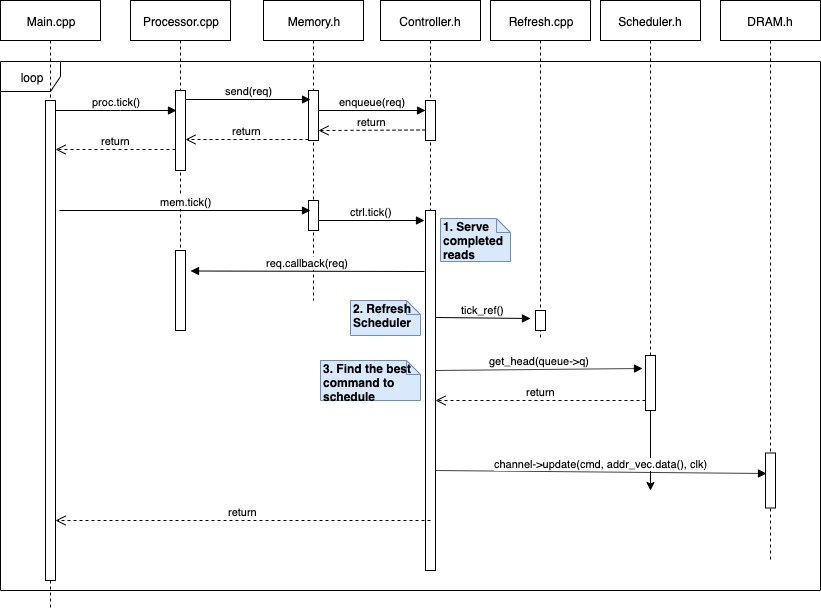
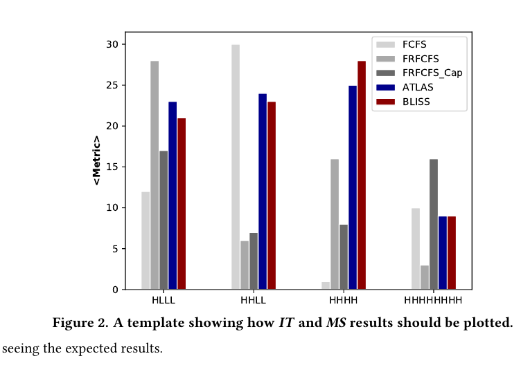

# 计算机架构（227-2210-00L），2022 年秋季

# 实验 4：内存请求调度

**主讲：PROF. ONUR MUTLU**

助教：JUAN GÓMEZ LUNA、MOHAMMAD SADROSADATI、JISUNG PARK、MOHAMMED ALSER、ATABERK OLGUN、CAN FIRTINA、RAHUL BERA、JOÃO DINIS FERREIRA、GERALDO FRANCISCO DE OLIVEIRA JUNIOR、KONSTANTINOS KANELLOPOULOS、NIKA MANSOURI GHIASI、ABDULLAH GIRAY YAGLICI、RAKESH NADIG、HAOCONG LUO、JOEL LINDEGGER、NISA BOSTANCI、BANU CAVLAK、ADITYA MANGLIK、YAHYA CAN TUGRUL

**布置时间：2022 年 11 月 14 日（周一）**
**截止时间：2022 年 11 月 28 日（周一）（午夜）**

## 1. 引言

在本实验中，你将实现并评估两种内存调度策略：ATLAS [1] 和 BLISS [2]。为此，你将扩展 Ramulator [3]——一个公开可用的架构内存模拟器——来建模这两种内存调度策略。Ramulator 实现了许多 DRAM 标准（例如 DDR4、LPDDR4、WideIO）。它还实现了一个简单的乱序处理器前端，使 Ramulator 可以作为独立工具模拟工作负载。我们在第 2 节提供了关于 Ramulator 的更多信息，并指导你如何使用它。

我们提供给你的 Ramulator 版本已经建模了诸如先来先服务（FCFS）和先就绪先来先服务（FRFCFS）之类的内存调度策略。在本作业中，你的工作是按照本讲义后面规定的实现 ATLAS 和 BLISS 调度策略。

## 2. 简短的 Ramulator 教程

请按照这个简短视频教程学习如何使用 Ramulator。

以下是教程的大纲：

- 下载和构建 Ramulator
- 模拟模式
- 模拟器输出
- 配置文件
- 模拟多程序工作负载
- 代码组织

### 2.1. 下载和构建 Ramulator

Ramulator [3] 是一个快速、周期精确的 DRAM 模拟器，支持广泛的商业以及学术 DRAM 标准。请使用下面的链接下载 Ramulator 后阅读 README。

**练习 0/6：** 在 Moodle 上的 Lab 4 中，我们提供了一个包含本次作业将使用的内存 trace 的 Ramulator 版本。请下载并解压 zip：

<https://moodle-app2.let.ethz.ch/pluginfile.php/1453342/mod_assign/introattachment/0/ramulator_lab.zip?forcedownload=1>

**练习 1/6 编译 Ramulator**

Ramulator 需要 C++11 编译器（例如 clang++、g++-5）。默认情况下，Ramulator 将使用 clang++ 构建。但是，你可以修改 Ramulator 目录中 'Makefile' 中以 `CXX:=` 开头的行来选用不同的编译器。

你可以通过运行 make 轻松构建 Ramulator：

```
$ make -j
```

编译成功后，你会在与 Makefile 相同的目录中找到一个名为 ramulator 的可执行二进制文件。你可以运行该二进制文件向终端打印帮助信息：

**练习 2/6 打印 Ramulator 帮助信息**

```
$ ./ramulator
Usage: ./ramulator <configs-file> --mode=cpu,dram [--stats <filename>]
                     <trace-filename> <trace-filename2>
Example: ./ramulator ramulator-configs.cfg --mode=cpu trace.cpu.trace
```

### 2.2. 模拟模式

Ramulator 支持三种不同的使用模式：

- **内存 Trace 驱动（Memory Trace Driven）：** 在此模式下，为 Ramulator 提供一个包含应用程序主存请求的输入 trace 文件进行模拟。Ramulator 基于所选 DRAM 标准（例如 DDR4）顺序处理这些请求。此模式没有以足够细节建模任何系统来执行时序模拟。正因如此，内存 Trace 驱动模式更适合测试新添加功能的功能性。在本作业中，我们不会使用此模式。不过，如果你感兴趣，可以在公开的 Ramulator 仓库 [4] 中找到有关此模式的更多信息。
- **Gem5 驱动（Gem5 Driven）：** Gem5 [5] 是一个详细建模 CPU 架构的全系统模拟器。Ramulator 可以挂接到 gem5 来模拟系统的主存组件。在本作业中，我们不会使用此模式。如果感兴趣，你可以查看 gem5 的主页了解该模拟器的更多信息。你还可以在这里找到如何把 Ramulator 挂接到 gem5。
- **CPU Trace 驱动（CPU Trace Driven）：** 这是你将在本实验作业中使用的模拟模式。在此模式下，Ramulator 直接从文件读取 CPU 指令 trace，并模拟一个简化的乱序 CPU 核模型，该模型向 DRAM 子系统产生内存请求。此类 trace 文件包含非内存指令和内存请求。根据 trace 文件的生成方式，trace 文件中的内存请求可能对应于某个缓存层级，或直接对应主存。如果 trace 包含主存请求，我们称之为缓存过滤 trace（cache-filtered trace）。模拟缓存过滤 trace 时，应将 Ramulator 配置为不实例化任何缓存。CPU trace 文件中的每一行代表一个内存请求，可以有以下三种格式之一：
  - `(num-cpunist) <addr-read>`：如果一行包含两个标记，第一个标记 (num-cpunist) 表示读请求之前的 CPU（即非内存）指令数。第二个标记 `<addr-read>` 指定读请求的内存地址。
  - `(num-cpunist) <addr-read> <addr-writeback>`：三个标记的行中前两个标记与第一种格式相同。第三个标记 `<addr-writeback>` 是写回请求的地址，即由之前的读请求引起的脏缓存行换出。
  - `(unused) (unused) (num-cpunist) (type) <addr>`：(unused) 标记用于向模拟传递附加信息，与本作业无关，会被 Ramulator 忽略。(num-cpunist) 表示内存请求之前的 CPU（即非内存）指令数。(type) 表示内存请求的类型，可以是 load（L）请求或 store（S）请求。(addr-read) 指定请求的内存地址。

### 2.3. 模拟器输出

Ramulator 为每次运行报告一系列统计信息。这些统计信息写入一个文件。默认情况下，文件名将是 '(standard_name).stats'（例如 'DDR4.stats'）。你可以通过在 --mode 参数之后添加 --stats <文件名> 到命令行，用自定义文件名输出统计信息。

**练习 4/6：理解 stats 文件：**

前一个任务中的模拟应该已创建 stats 文件 'DDR4.stats'。用你喜欢的文本编辑器（例如 emacs、gedit、vim、kate）打开 stats 文件，找出 Ramulator 默认报告哪些统计信息。填写下面指标的数值：

注意：你不需要提交你上面填写的 stats。这只是帮助你熟悉 Ramulator 的 stats 文件的练习。

1. 执行的指令数（Executed Instructions）：
2. CPU 周期（CPU Cycles）：
3. IPC：
4. 行缺失（Row Misses）：
5. 行命中（Row Hits）：
6. 行冲突（Row Conflicts）：
7. 平均访问延迟（Average access latency）：
8. 读带宽（Read Bandwidth）：
9. 写带宽（Write Bandwidth）：

### 2.4. 配置文件

Ramulator 能够对多种内存技术进行周期精确模拟。它使用各种配置文件来模拟不同的内存技术。现在，让我们分析配置文件中的重要参数。

预定义的配置文件可在 'configs/' 目录中找到。Ramulator 能够模拟标准 DDRx 内存（例如 DDR3-config.cfg、DDR4-config.cfg、GDDR5-config.cfg）、新的 3D 堆叠内存（例如 HBM-config.cfg、WideIO2-config.cfg）、非易失性新兴内存技术（例如 PCM-config.cfg、STTMRAM-config.cfg），以及学术提案（例如 SALP-config.cfg、DSARP-config.cfg）。关于展示 Ramulator 评估工作负载-DRAM 配置能力的最新研究，请参阅 Ghose 等人 [5] 的 SIGMETRICS 2019 论文《Demystifying Complex Workload-DRAM Interactions: An Experimental Study》。

在本作业中，你将模拟基于 DDR4 的主存。如果你打开 DDR4 配置文件，你会看到几个描述要模拟系统的参数。下面是最重要参数的描述：

1. **内存特定参数：** 这些参数指定内存设备如何配置。重要参数有：
   - standard：指定 DRAM 标准（例如 DDR4）。
   - channels、ranks：这些指定模拟 DRAM 子系统的 DRAM 通道数和每通道的 rank 数。
   - speed：此参数指定模拟 DRAM 设备的时序特性（例如 DDR4_2400R）。它设置 DRAM 设备的频率和内部 DRAM 时序。
   - org：指定 DRAM 设备的内部组织（例如组、行、列的数量）。
2. **核特定参数：** 这些指定 CPU 核的配置。Ramulator 实现一个简单的乱序核模型，以及一个非一致的缓存层次。核的数量由执行时作为参数传递的 trace 文件数量决定（例如，第一个 trace 分配给第一个核）。缓存层次可以使用 cache 旋钮配置：no 表示无缓存，L1L2 表示私有 L1 和 L2 缓存，L3 表示核间共享的仅 L3 缓存，all 表示私有 L1 和 L2 以及共享 L3。在本作业中，你不应该实例化任何缓存，因为我们提供给你的缓存过滤 trace。
3. **模拟特定参数：** 这些参数控制模拟。由于模拟一个程序所需时间可能比在真实系统上执行同一程序多几个数量级，一种常见做法是限制模拟的指令数（expected_limit_insts）。设置此参数将使模拟在所有核至少退休 expected_limit_insts 条指令时结束。请确保保持 early_exit 关闭，否则模拟会在任何核退休 expected_limit_insts 条指令时就结束。

### 2.5. 模拟多程序工作负载

Ramulator 允许模拟多程序工作负载。多程序工作负载由多个独立应用程序组成，每个应用程序分配给一个 CPU 核。这些应用程序彼此不通信。因此，不需要缓存一致性机制。但是，由于各个应用程序共享内存子系统，它们仍然在内存层次的不同层级上相互干扰。

要创建多程序模拟，你只需在命令行中指定多个 trace 文件，用空格分隔。Ramulator 将每个 trace 分配给一个不同的核。例如，如果你提供两个 trace 文件（例如 trace1 trace2），Ramulator 将自动实例化两个 CPU 核，并把每个 trace 分配给不同的核。

在 '/traces' 目录中，我们提供了两个 CPU trace 文件。其中一个表示一个大量访问主存的应用程序（即内存强度高），另一个对主存发出的请求较少。

**练习 5/6：运行多程序工作负载：**

以下命令启动模拟，使用我们提供的 './traces/' 目录中每个 trace 文件各一个实例。

```
$ ./ramulator configs/DDR4-config.cfg --mode=cpu --stats \
    multi-programmed-simulation.stats ./traces/high-mem-intensity.trace \
    ./traces/low-mem-intensity.trace
```

注意，在 stats 文件中，一些统计信息是为每个核分别收集并在输出中显示的。

### 2.6. 代码组织

Ramulator 抽象了基本 DRAM 操作，以提供易于扩展的设计。你可以阅读 Ramulator 论文 [3] 中的第 2 节，详细了解代码的组织方式。

在本节中，我们对不同 Ramulator 模块如何相互通信给出一个高层视图。图 1 提供了 Ramulator 功能的简化视图。我们分两个模拟阶段描述 CPU Trace 驱动模拟：处理器和内存。

**处理器侧模拟。** 模拟的处理器侧阶段包括：1) 读取 trace 文件；2) 发出气泡指令（即非内存指令）；3) 发出内存指令。处理器在 'src/Core.h' 中实现一个简单的乱序核模型，在 'src/Cache.h' 中实现缓存子系统。它的工作方式如下。

1. 'src/Main.cpp' 读取配置文件，并实例化处理器核和内存控制器。创建的核对象数量取决于传给模拟的 trace 文件数量，创建的控制器对象数量取决于配置中的 DRAM 通道数。
2. run_cputrace() 开始运行，然后控制模拟的执行。
3. 处理器模块被 tick（proc.tick()），这推进模拟到下一个时钟周期。
4. 处理器 tick 核和缓存子系统。在每个时钟周期，每个核从其 trace 文件读取指令。当一个核从模拟 trace 收到内存指令时，该核调用 send() 把内存请求转发到相应的缓存（如果配置文件定义了缓存）或内存控制器。send() 实现确定哪个控制器应该服务该请求的功能。然后，一旦控制器完成服务请求，它通过调用 callback() 通知发出请求的核，callback() 是作为成员变量随请求对象一起传递的函数。



*图 1. 描述 Ramulator 如何运行的时序图。*

**内存侧模拟。** 模拟的内存侧阶段有三个主要任务：1) 服务已完成的读；2) 刷新内存设备；3) 调度 DRAM 命令。内存模块实现一个内存控制器（每个 DRAM 通道一个），负责执行这三个任务。内存侧模拟的工作方式如下。

1. 'src/Main.cpp' tick 内存模块（memory.tick()），这推进模拟到下一个时钟周期。然后内存模块 tick 每个内存控制器。
2. **服务已完成的读。** 控制器检查是否有任何请求已完成，如果有，它通过调用相应的 req.callback(req) 函数通知发出该请求的核。
3. **刷新内存设备。** 控制器调用刷新模块，该模块负责在定义的刷新间隔发出刷新命令。
4. **调度 DRAM 命令。** 内存调度器确定内存请求队列中的哪个请求应被下一个服务。所选请求取决于正在使用的调度策略。每个周期，调度器使用调度策略扫描队列中的请求，找到下一个最合适的请求来服务，正如所用的调度策略所规定的那样。如果有任何这样的请求准备好被服务，调度器就把该请求转发给控制器，控制器发出适当的 DRAM 命令（例如 READ、ACTIVATE）来服务该请求。然后，控制器调用 channel->update() 更新 DRAM 设备的状态，以反映所发 DRAM 命令的效果。需要指出的是，每条 DRAM 命令的时序在标准 DRAM 规范（即数据手册）中定义。每个内存技术文件（例如 'src/DDR4.h'）为实现该标准的不同设备类型定义了时序规范。关于时序参数，你可以在 'src/DDR4.h' 中看到 SpeedEntry 结构。

现在，让我们看看不同的内存调度策略如何影响性能。用你喜欢的文本编辑器打开 'src/Scheduler.h'。默认情况下，Ramulator 采用 FRFCFS_Cap 调度器 [7]。你可以通过修改下面显示的行来更改此调度器：

```
type = Type::FRFCFS_Cap; //Change this line to change scheduling policy
```

**练习 6/6：修改 Ramulator 源代码：**

更改适当的源文件，使 Ramulator 使用 FCFS（先来先服务）内存调度器。更改后，再次运行 make 用最新更改编译 Ramulator。然后模拟高内存强度 trace，比较 FCFS 与默认 FRFCFS_Cap 策略的执行时间。

## 3. 你的任务 1/3：实现 ATLAS

你的目标是通过实现自适应每线程最少获得服务（Adaptive per-Thread Least-Attained-Service, ATLAS）调度器 [1] 来扩展 Ramulator。ATLAS 的关键思想是，根据线程从内存控制器获得的服务量对线程进行优先级排序，并在每个周期优先处理与其他线程相比获得最少服务的线程。如 Kim 等人 [1] 所示，这种技术显著减少了 CPU 核停顿的时间，从而提高系统吞吐量。

你的任务是按照提出 ATLAS 的论文 [1] 第 3–5 节的描述，用 ATLAS 调度策略扩展 Ramulator。虽然你应该坚持论文中描述的确切机制，但弄清楚如何在 Ramulator 中实现 ATLAS 是你的任务。有多种方法可以用新的内存调度策略扩展 Ramulator。例如，你可以在 'Scheduler.h' 中添加 ATLAS 作为一种新的调度器类型（类似于 FCFS 等其他策略），并修改/添加该头文件中的函数。我们不会提供具体的软件设计，你可以自由地以你认为合适的方式在 Ramulator 中实现 ATLAS。

虽然我们不限制你采用具体的软件实现，但你应该确保你的 ATLAS 实现与论文中描述的机制功能等价。另外，请使用论文第 6 节末尾提供的 ATLAS 机制默认配置（即量子长度 = 1000 万周期，α = 0.875，T = 10 万周期）。

## 4. 你的任务 2/3：实现 BLISS

在这第二个任务中，你的目标是通过实现 BLISS 调度器 [2] 来扩展 Ramulator。BLISS 的关键思想是把应用程序分成两组，一组包含内存强度高的应用程序，另一组包含访问内存较少的应用程序。BLISS 调度器通过识别重复多次访问一行的应用程序，并在确定的时间段内降低其优先级来实现分组。如 Subramanian 等人 [2] 所示，BLISS 减少了两组之间的干扰，提高了系统吞吐量和公平性。

你的任务是按照提出 BLISS 的论文 [2] 第 4–5 节的描述，用 BLISS 调度策略扩展 Ramulator。与任务 1 类似，我们不会提供在 Ramulator 中的具体实现方式，你可以自由地以你认为合适的方式在 Ramulator 中实现 BLISS。

虽然我们不限制你采用具体的软件实现，但你应该确保你的 BLISS 实现与论文中描述的机制功能等价。另外，请使用论文第 6 节末尾提供的 BLISS 机制默认配置（即 Blacklisting Threshold = 4，Clearing Interval = 10K cycles）。

## 5. 你的任务 3/3：评估 ATLAS 和 BLISS，并与传统内存调度策略比较

你的任务现在是在三种基线调度策略（FCFS、FRFCFS 和 FRFCFS_Cap）之上，评估你的 ATLAS 和 BLISS 实现提供的指令吞吐量（IT）和最大减速比（MS）。使用以下指令吞吐量（IT）和最大减速比（MS）的定义：

> **指令吞吐量（IT）** = ∑(c=0..NumCores) InstructionsRetired(c) / CPUCycles

这基本上就是每个核退休的所有指令之和除以模拟完成所需的总 CPU 周期数。

> **最大减速比（MS）** = max(a∈Applications) (CPUCycles_shared(a) / CPUCycles_alone(a))

要计算单个应用程序的减速比，只需把应用程序与同一系统中的其他应用程序一起运行时的执行时间，除以在同一系统上单独运行该应用程序的执行时间。最大减速比（MS）是多程序工作负载内单个应用程序减速比的最大值。

作为评估的第一部分，你必须把指令吞吐量作为统计信息添加到 Ramulator 中，使输出的 'stats' 包含一个新的 instruction_throughput 行。为此，你首先需要使用 ScalarStat 类，以与 Ramulator 中已有的其他统计信息类似的方式创建它的一个实例。

你必须按照上面的公式计算指令吞吐量。

不可能直接把 MS 作为统计信息添加到 Ramulator，因为它需要多次运行 Ramulator（一次把所有应用程序放在一起，一次单独运行目标应用程序）来收集计算 MS 所需的信息。因此，你需要手动计算 MS，或编写一个脚本，读取多个 Ramulator stats 文件并返回每个应用程序的 MS。

运行模拟时请执行以下操作：

1. 确保除了本作业中明确提到可以更改的部分外，不更改处理器和内存配置。
2. 运行模拟直到每个核退休 2000 万条指令。
3. 对于每种调度策略，运行以下多程序工作负载：
   - 工作负载 1：HLLL（四核）
   - 工作负载 2：HHLL（四核）
   - 工作负载 3：HHHH（四核）
   - 工作负载 4：HHHHHHHH（八核）

其中 H 代表高内存强度 trace 的一个实例，L 代表低内存强度 trace。我们提供两个 trace，如第 2.1 节所述。

使用以下内存调度器运行 Ramulator，收集这些运行的指令吞吐量和 MS，并分析结果。

- **FCFS（先来先服务）：** 最先插入内存请求队列的内存请求先被服务。
- **FRFCFS（先就绪先来先服务）：** 与 FCFS 类似，但请求队列中针对已打开行的请求被优先处理。
- **FRFCFS_Cap：** 与 FRFCFS 类似，但可从已打开行服务的读/写请求数量受到限制，以防止针对同一组中不同行的其他请求饥饿。换句话说，使用此策略时，一行一旦被激活，只能服务一定数量的读/写请求，然后必须关闭（不要更改 FRFCFS_Cap 的默认参数）。更详细的描述和评估见 [7]。
- **ATLAS：** 这是你在 [1] 中描述的 ATLAS 调度器的实现。
- **BLISS：** 这是你在 [2] 中描述的 BLISS 调度器的实现。

使用上述每种调度策略评估每个工作负载。收集指令吞吐量（IT）和最大减速比（MS）结果，并按照图 2 中的模板绘图。注意，你应该为全部五种调度策略和四个多程序工作负载，在单独的图中显示 IT 和 MS 结果。



*图 2. 展示应如何绘制 IT 和 MS 结果的模板。*

基于你的分析，请在实验报告中提交以下问题的答案。

1. 提供两张图，一张 IT 一张 MS，描绘 4 个不同工作负载和 5 种不同调度策略的指标。
2. 解释这两张图。
3. 使用每种调度策略时，吞吐量和 MS 指标如何变化？解释原因。
4. 结果符合你的预期吗？清楚解释你预期每种调度策略会产生什么样的差异。如果结果不符合你的预期，尝试推理你可能没看到预期结果的原因。

## 6. 加分任务（25% 额外学分）：设计你自己的内存调度器

在此任务中，你的目标是提出一个新的内存调度想法（或多个想法），希望能比现有的五种调度策略表现更好。要产生新想法，你可能需要更详细地查找和研究先前的工作，并覆盖该领域的研究。或者，你可以发挥你的创造力和洞察力。你可以自由提出任何类型的内存调度想法，只要是你自己的。

以类似于你在任务 3 中评估 ATLAS 和 BLISS 的方式评估你的想法。把你新想法与我们所提及的全部五种调度策略进行比较。

提交 1) 你想法的详细描述，2) 该想法的 Ramulator 实现，以及 3) 你新策略的结果。你可以创建类似于你为任务 3 创建的图。

如果你提出一个好的内存调度想法，且优于本作业中提及的五种调度策略，你可以获得整个课程成绩的 1.5%。特别有创造力和洞察力的想法也可能获得学分。

## 7. 小贴士

- 请勿分发所提供的程序文件。这些仅供计算机架构课程的每位学生个人独占使用。分发和共享违反了向你提供的软件的版权。
- 仔细阅读本讲义。
- 如有需要，请通过 Moodle 中的在线问答论坛向助教提问：<https://moodle-app2.let.ethz.ch/mod/moodleoverflow/view.php?id=826791>
- 遇到技术问题时，请先阅读错误信息。网络搜索通常能解决许多调试问题和错误信息。

## 8. 提交

使用 Moodle 中相应的作业 <https://moodle-app2.let.ethz.ch/mod/assign/view.php?id=825905>。你应该提交：

- 所有编译代码所需的文件（包括你没有更改的 Ramulator 源文件）。
- 一份 PDF 格式的报告，包含两个主要部分：1) 简要解释你在 Ramulator 中为实现新调度策略所做的更改的部分，2) 关于你在任务 3 中分析的部分，包括绘制的结果。
- 与你在任务 3 中分析相关的所有 .stat 文件。
- 请**不要**提交 Moodle 上提供给你的 Ramulator trace 文件。
- 另外，请不要提交编译过的文件（例如 Ramulator 可执行文件、obj 文件）。

请将上述文件放在一个 tarball 中提交（命名为 'lab4_你的姓_你的名.tar.gz'）。

## 参考文献

[1] Yoongu Kim, Dongsu Han, Onur Mutlu, and Mor Harchol-Balter. ATLAS: A Scalable and High-Performance Scheduling Algorithm for Multiple Memory Controllers. In HPCA, 2010.

[2] Lavanya Subramanian, Donghyuk Lee, Vivek Seshadri, Harsha Rastogi, and Onur Mutlu. BLISS: Balancing Performance, Fairness and Complexity in Memory Access Scheduling. TPDS, 2016.

[3] Yoongu Kim, Weikun Yang, and Onur Mutlu. Ramulator: A Fast and Extensible DRAM Simulator. In CAL, 2015.

[4] SAFARI Research Group. Ramulator: A DRAM Simulator — GitHub Repository. <https://github.com/CMU-SAFARI/ramulator>

[5] Nathan Binkert, Bradford Beckmann, Gabriel Black, Steven K Reinhardt, Ali Saidi, Arkaprava Basu, Joel Hestness, Derek R Hower, Tushar Krishna, Somayeh Sardashti, et al. The gem5 Simulator. ACM SIGARCH Computer Architecture News, 2011.

[6] Saugata Ghose, Tianshi Li, Nastaran Hajinazar, Damla Senol Cali, and Onur Mutlu. Demystifying Complex Workload-DRAM Interactions: An Experimental Study. In SIGMETRICS, 2019.

[7] Onur Mutlu and Thomas Moscibroda. Stall-Time Fair Memory Access Scheduling for Chip Multiprocessors. In MICRO, 2007.
