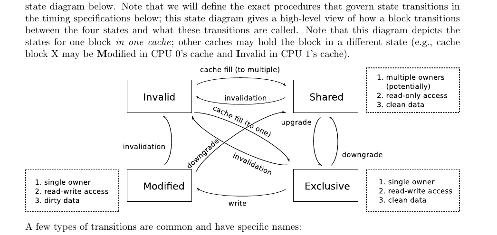
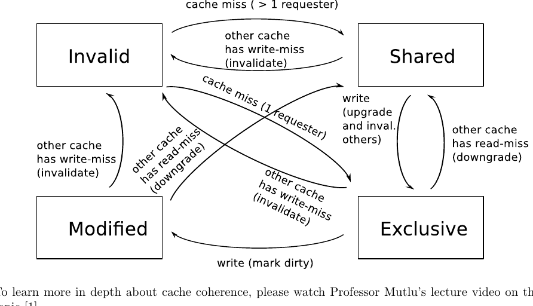

# 计算机架构（227-2210-00L），2022 年秋季

# 实验 6：多核与缓存一致性（加分）

**主讲：PROF. ONUR MUTLU**

助教：JUAN GÓMEZ LUNA、MOHAMMAD SADROSADATI、MOHAMMED ALSER、ATABERK OLGUN、CAN FIRTINA、RAHUL BERA、JOÃO DINIS FERREIRA、GERALDO FRANCISCO DE OLIVEIRA JUNIOR、KONSTANTINOS KANELLOPOULOS、NIKA MANSOURI GHIASI、ABDULLAH GIRAY YAGLICI、RAKESH NADIG、HAOCONG LUO、JOEL LINDEGGER、NISA BOSTANCI、BANU CAVLAK、ADITYA MANGLIK、YAHYA CAN TUGRUL

**布置时间：2022 年 12 月 26 日（周一）**
**截止时间：2023 年 1 月 15 日（周日）（晚上 11:59）**

## 1. 目标

在本实验中，你将扩展实验 2 的模拟器，建模一个具有缓存一致内存层次结构的多核系统。我们将描述缓存一致性协议如何工作，以及模拟器的功能接口将如何改变以支持多个线程。

## 2. 多核：功能更改

在我们建模多核系统的微架构细节之前，我们需要扩展系统的功能接口，以便用户的程序可以使用多个线程。在本实验中，我们对功能（ISA 级）接口进行以下更改：

- 系统有四个 CPU（标记为 CPU 0 到 CPU 3）。所有 CPU 都有私有架构状态（寄存器堆和程序计数器），但共享内存。因此，如果 CPU 0 向地址 0x10000000 存储一个值，随后 CPU 1 从地址 0x10000000 加载，CPU 1 应该收到 CPU 0 存储的值。
- 所有 CPU 相互独立，除了共享的内存层次结构（L2 缓存、L2 MSHR 和 DRAM 子系统）。你应该为每个 CPU 复制流水线、分支预测器和 L1 缓存。
- 最初，只有 CPU 0 在运行。因此，如果运行一个单线程程序，它的行为应该与在先前实验的 MIPS 实现上运行完全相同。
- 要在另一个 CPU 上启动线程，我们定义一个新的系统调用来产生（spawn）线程。当 SYSCALL 指令以 $v0 = 1、2 或 3 执行时，就在 CPU 1、2 或 3 上产生一个新线程。要产生线程，相应 CPU 的程序计数器被设置为 SYSCALL 之后指令的 PC（PC + 4），相应 CPU 上的 $v1 寄存器被设置为 1。调用 SYSCALL 的 CPU 上的 $v1 寄存器被设置为 0。因此，从程序的角度看，执行在系统调用后同时在发起 CPU 和新启动的 CPU 上继续，$v1 寄存器用于区分哪个线程是新线程、哪个是原始线程。¹ 当新线程产生时，执行在随后的周期开始。（我们只测试产生线程的 SYSCALL 被调用到当前未执行、且流水线中没有指令的 CPU 上的情况。）
- 为了更容易测试程序，我们添加一个新的控制台输出系统调用。当 SYSCALL 以 $v0 = 11 执行时，模拟器把 $v1 中的值作为 SYSCALL 参数，并在标准输出打印一行，如 "OUT (CPU 2): 1234ffe"。
- 程序终止系统调用（$v0 = 10）现在只停止当前 CPU。模拟一直持续到所有 CPU 都停止。

> ¹这是 Unix fork() 系统调用的简化版本。

## 3. 模拟器 Shell 更改

对于本实验，你需要修改 shell。与之前的实验不同，现在允许你修改 shell.c 和 shell.h。为了方便评分，我们规定你的模拟器必须产生的确切输出（请确保你提交的模拟器不发出任何调试输出；任何额外输出都将被视为不正确的结果）。

除我们下面规定的输出外，你的模拟器不应在标准输出上打印任何输出。（这意味着你应该删除 shell 中的欢迎文本和提示符。）

我们要求你的模拟器只支持以下命令：

- **go**：执行直到所有 CPU 停止。只有在执行控制台输出系统调用时才应产生输出。
- **run N**：运行 N 个周期。如上所述，只应打印控制台输出。如果执行在 N 个周期之前完成，模拟器应在那时停止。
- **i X Y**：把 CPU 0 上的寄存器 X 设置为值 Y。
- **rdump**：转储所有四个 CPU 的寄存器状态。你的模拟器应该打印一行 "CPU n"，然后是 "PC: 0x01abcdef"、"R0: 0x00000000" 到 "R31: 0xdeadbeef"、"HI: 0x00000000" 和 "LO: 0x00000000" 各行（替换为适当的值）。在四个 CPU 寄存器转储之后，应该有一行 "Cycles: n"。不应有空行。

注意，命令 go、run 和 i 与以前一样工作。只有 rdump 必须修改以显示所有 CPU 的寄存器状态。

当标准输入到达 EOF 时，模拟器应退出，不打印任何额外输出。

## 4. 缓存一致性的高层视图

当多个 CPU 共享同一内存层次结构，但拥有自己的 L1 数据和指令缓存时，如果给定缓存块的两个或多个副本存在于两个 CPU 的缓存中，并且这些块之一被修改，就可能发生不正确的执行。

考虑 CPU 0 和 CPU 1 都在其 L1 数据缓存中拥有块 X 副本的情况。最初，该块是从两个 CPU 共享的 L2 缓存读取的，所以块的两个副本包含相同的值。如果 CPU 0 或 CPU 1 执行 load 指令读取块 X 中的值，执行是正确的。但是，如果 CPU 0 执行一条修改块 X 中值的 store 指令，随后 CPU 1 从块 X 执行 load 指令，该 load 指令必须看到新值。因此，新值必须以某种方式传播到 CPU 1 中块 X 的副本。这被称为缓存一致性问题（cache coherence problem）。一组管理多个缓存如何相互作用以解决此问题的规则被称为缓存一致性协议（cache coherence protocol）。

支持一致性的缓存系统可以用多种方式构建。对于本实验，我们将专注于当今使用的最常见方案之一，即基于失效（invalidation-based）的缓存一致性协议。基于失效的协议通过确保一旦 CPU 请求写入一个缓存块，该 CPU 必须使（移除）其他任何包含该块的 CPU 缓存中的块副本失效，来解决缓存一致性问题。然后请求 CPU 拥有缓存块的唯一副本，并能修改其内容。之后，当任何其他 CPU 试图读取该块时，它将经历缓存缺失，必须从修改数据的 CPU 获取新数据。这种交互发生的确切方式将在下面变得清晰。

基于失效的缓存一致性协议通过强制执行以下不变量（在必要时使缓存块失效）来确保所有 CPU 在其缓存中看到正确的值：

> **基于失效的协议不变量。** 任何缓存块 X 要么以可写状态存在于最多一个缓存中，要么以只读状态存在于多个缓存中。

在本实验中，我们将实现 MESI 缓存一致性协议（也称为伊利诺伊协议 [2]）的简单版本。MESI 协议是一种基于失效的协议，以 L1 缓存中缓存块可以具有的四种状态命名：Modified（修改）、Exclusive（独占）、Shared（共享）或 Invalid（无效）。这些状态定义如下：

- **Modified（修改）：** 当缓存块处于 Modified 状态时，它相对于内存层次的共享层级是脏的。它也是实现 MESI 的缓存中给定数据的唯一副本，因此拥有 Modified 块缓存的 CPU 可以随意进行进一步更改。
- **Exclusive（独占）：** 当缓存块处于 Exclusive 状态时，它相对于内存层次的共享层级是干净的，但它仍然是实现 MESI 的缓存中数据的唯一副本。因此，如果拥有 CPU 想要写入该块，它可以在不咨询任何其他 CPU 的情况下把块的状态更改为 Modified。
- **Shared（共享）：** 当缓存块处于 Shared 状态时，它相对于内存层次的共享层级是干净的。此外，不保证它是实现 MESI 的缓存中缓存块的唯一副本。因此，该块是只读的。如果 CPU 想读取处于 Shared 状态的块，它可以这样做；但是，如果它想写入，那么块必须转换到 Exclusive 状态（如下所述）。
- **Invalid（无效）：** 最后，Invalid 状态表示缓存中不存在的缓存块。

Shared 状态有时被称为多所有者（multiple-owner）状态，因为多个缓存可以包含处于此状态的同一缓存块。同理，Exclusive 和 Modified 状态有时被称为单所有者（single-owner）状态，因为当单个缓存以这些状态之一包含该块时，没有其他缓存可以包含该块。

一个块在 Modified、Exclusive、Shared 和 Invalid 四种状态之间转换，如下面的状态图所示。注意，我们将在下面的时序规范中定义控制状态转换的确切过程；此状态图给出了块如何在四种状态之间转换以及这些转换如何命名的高层视图。还请注意，此图描绘的是一个缓存中一个块的状态；其他缓存可以以不同的状态持有该块（例如，缓存块 X 可能在 CPU 0 的缓存中是 Modified，在 CPU 1 的缓存中是 Invalid）。

几种类型的转换是常见的，有特定名称：

- 从 Shared 到单所有者状态（Exclusive 或 Modified）的转换称为**升级（upgrade）**，因为该转换授予所有者（包含相应块的缓存）写入该块的能力。
- 从单所有者状态（Exclusive 或 Modified）到 Shared 的转换称为**降级（downgrade）**，因为该转换夺走所有者修改数据的权利（以换取跨多个缓存共享副本的能力）。
- 从 Modified、Exclusive 或 Shared 中的任何一个到 Invalid 的转换称为**失效（invalidation）**。这样的转换允许另一个缓存进入单所有者状态，以便相关 CPU 可以修改数据。

这些转换发生场景的概览如下所示。注意，除非指定"其他缓存（other cache）"，否则这些转换是从单个缓存的角度看的。我们将在下面的时序规范中更详细地描述每种具体情况。（> 1 requester）

要更深入地了解缓存一致性，请观看 Mutlu 教授关于该主题的讲座视频 [1]。

## 5. 时序规范：缓存一致内存层次结构

你的工作是从实验 2 的模拟器开始，以周期精确的方式实现以下行为。除非本实验的规范覆盖了早期实验的规范，否则实验 1 和实验 2 的所有规范仍然适用于本实验。

- **CPU 按升序（CPU 0、CPU 1、CPU 2、CPU 3）逐个周期模拟。** 因此，先模拟 CPU 0 的第 0 周期，然后模拟 CPU 1 的第 0 周期，等等。当两个或多个 CPU 在同一周期执行必须仲裁的动作时，此顺序打破平局，除非另有规定。在所有 CPU 各步进一个周期后，再模拟内存系统的一个周期。
- 还请注意，在本实验中，一个缓存在一个周期内可以发生多个事件（逻辑顺序由上述规则规定）。建模 LRU 替换时，确保你能正确处理这种情况。
- 分支恢复不再取消指令缓存缺失，为了简化。（正如我们将看到的，缓存一致性已经够复杂了，不需要回滚被取消请求的副作用！）
- 为了确保关于系统调用的正确性，SYSCALL 指令现在使流水线串行化。当 SYSCALL 指令处于译码级时，如果任何指令处于后续级（执行、访存、写回），它必须在译码级停顿。当 SYSCALL 处于执行、访存或写回级时，译码级中的任何指令必须停顿，直到 SYSCALL 离开流水线。SYSCALL 的动作在 SYSCALL 指令到达写回级时生效。

要理解我们为什么引入这种流水线串行化，请考虑在流水线 CPU 中如何维护程序顺序的正确性。对于大多数可以在流水线指令之间创建依赖关系的资源，CPU 工作正确，要么因为资源恰好在一个流水线级中处理（例如，store-to-load 依赖处理正确，因为 store 和 load 在访存级按程序顺序执行），要么因为 CPU 实现完全旁路（例如，对于寄存器流依赖）。然而，系统调用可以引入不明显依赖，因为它们实现系统中的"特殊"动作；例如，当线程终止时，流水线中系统调用之后的所有指令必须被作废。在之前的实验中，你可能为这个特定情况引入了一个特定的修复。但是因为系统现在有更广泛的系统调用，CPU 通过强制执行 SYSCALL 单独在流水线中执行的约束，更简单地确保正确性。

- **L2 缓存与实验 2 具有相同的参数。** 但是，它现在每个块有一个脏位。
- **指令和数据 L1 缓存与先前实验具有相同的参数，除了它们现在是一致的，实现本讲义描述的 MESI 缓存一致性协议。** 为支持这一点，每个缓存块有一个 2 位 MESI 状态。该状态可以指示块是 Modified、Exclusive、Shared 或 Invalid（如本讲义前面所述）。以 Modified 或 Exclusive 状态存在的缓存块在任何 load（或 store）时命中。对 Exclusive 状态块的 store 把该块升级到 Modified 状态。以 Shared 状态存在的缓存块在任何 load 时命中，但在任何 store 时产生升级缺失（upgrade miss）。任何其他访问都是缺失。
- **每个 L1 缓存现在有一个 MSHR，跟踪该缓存的未完成请求（如果有）。** MSHR 有字段指示所请求的块、请求是读（load）还是写（store）、以及数据在哪个周期准备好。
- **在缓存缺失时**（可能由于对 Shared 状态块写入时发生的数据升级所致，如前面所述，或者只是当请求的数据不在缓存中时），缓存控制器在缺失的周期执行以下过程。注意，为了简化，所有这一切都是瞬时发生的，尽管由于每一步之间的依赖关系，真实系统会复杂得多。
  - **步骤 1（写排除，Write Exclusion）。** 如果任何其他 L1 缓存有待处理的对此块的写入（由 MSHR 状态定义），或者如果此新访问是写入且任何其他 L1 缓存有待处理的对此块的读取，那么此访问停顿，缓存控制器在下一周期从步骤 1 重新开始。（此规则在真实缓存层次中不存在，但我们在此包含它来消除许多角落情况并简化你的工作。）
  - **步骤 2（检查活动 MSHR）。** 缓存控制器扫描所有有效的 L2 MSHR，以确定是否已有另一个对同一块的缺失处于活动状态。如果是这种情况，那么此缺失只是停顿（已经活动的缺失最终将返回数据并满足此缓存缺失）。否则，缓存控制器继续到步骤 3。
  - **步骤 3（确保 MSHR 可用）。** 此时，该请求是对一个新块的 L1 缺失，没有其他请求待处理。首先，如果没有可用的 L2 MSHR，此访问停顿。缓存控制器在下一周期从步骤 1 重新开始。L2 MSHR 仅对 L2 缺失是必需的，所以我们在此时不分配 MSHR。然而，在此处停顿消除了在缓存控制器发现没有空闲 L2 MSHR 之后（例如，在步骤 5 中确定此访问是 L2 缺失之后）从半更新状态退出的需要。
  - **步骤 4（探测其他 L1 缓存）。** 所有其他 L1 缓存被探测（假设每个缓存有足够的端口，可以在单个周期内发生任意数量的此类探测）。如果在任何其他 L1 缓存中存在该数据，则缓存控制器继续进行步骤 4a（如果正在服务的请求是读）或步骤 4b（如果正在服务的请求是写）。
    - **步骤 4a（在其他 L1 中找到，读）。** 如果缓存控制器在任何其他缓存中找到请求的缓存块，并且此请求是读，则发生以下情况。缓存控制器把找到它的所有其他缓存中块的状态降级为 Shared 状态，并更新该缓存的 LRU 顺序。该数据将以 Shared 状态插入请求 CPU 的 L1 缓存。如果被降级的块先前在找到它的 L1 缓存中是 Modified，则按如下方式向 L2 执行写回。如果该块存在于 L2 缓存中，则设置该块的脏位并更新 LRU 顺序（因为该块被写回访问）。否则，不向 L2 缓存发生写回。（在真实系统中，写回的地址会导致 L2 缺失，这可能引起 L2 中的另一次换出；我们为简化省略了这一点。）相反，脏块在同一周期内立即写入主存，而不更新 L2 缓存。缓存控制器继续进行步骤 4c。
    - **步骤 4b（在其他 L1 中找到，写）。** 如果缓存控制器在任何其他缓存中找到请求的缓存块，并且此请求是写，则发生以下情况。缓存控制器使在找到它的任何其他 L1 缓存中的数据失效。控制器然后把数据插入请求 CPU 的 L1 缓存。如果该块在找到它的 L1 缓存中处于 Modified 状态，则以 Modified 状态插入（脏数据因此被传输，而不向 L2 写回）。否则，该块以 Exclusive 状态插入，但立即被写入设置为 Modified。缓存控制器继续进行步骤 4c。
    - **步骤 4c（L1 写回）。** 当请求的缓存块在步骤 4a 或步骤 4b 中被插入请求 CPU 的 L1 缓存时，如果另一个缓存块被换出且被换出缓存块的状态是 Modified，则按步骤 4a 中描述的方式处理从 L1 到 L2 的写回。
  - 如果缓存缺失在步骤 4 中得到满足，则该缺失需要 5 个周期完成。
  - **步骤 5（探测 L2 缓存）。** 如果缺失尚未被满足，缓存控制器探测 L2 缓存。如果数据存在于 L2 缓存中，控制器更新 L2 缓存上的 LRU 顺序，并把新块插入请求 CPU 的 L1 缓存。如果此访问是由于写（store），块以 Modified 状态插入；如果此访问是由于读（load），块以 Exclusive 状态插入。如果由于此 L1 插入而换出一个块，则其写回按步骤 4a 处理。
  - 如果缓存缺失在步骤 5 中得到满足，则该缺失需要 15 个周期完成。
  - **步骤 6（去内存）。** 控制器现在已经确定该请求是 L2 缺失，必须从主存加载数据。此时，分配一个 L2 MSHR，内存请求处理按实验 2 进行（即内存请求在五个周期的传输延迟后被放入内存请求队列）。
- **每当内存请求完成且数据在 L2 控制器处准备好时（请求完成后 5 个周期，如实验 4 中所规定），发生以下缓存填充序列。**
  - **步骤 1（L2 插入）。** 与请求地址关联的缓存块被插入 L2 缓存。对此插入从 L2 缓存换出的任何数据不执行写回处理。
  - **步骤 2（L1 插入）。** 缓存控制器扫描所有 L1 MSHR。对于任何有待处理请求、请求从内存返回的缓存块的 L1 MSHR，新块被插入关联的 L1 缓存。如果此待处理请求是写（store），新块将具有 Modified 状态；如果此待处理请求是读（load）且是对被插入缓存块地址的唯一待处理请求，新块将具有 Exclusive 状态；否则为 Shared 状态。如果此 L1 缓存因新块插入而换出一个块，则按步骤 4a 中所述处理该被换出块的写回。
  - **步骤 3（释放 MSHR）。** 缓存控制器释放与此请求关联的 L2 MSHR。
  - **步骤 4（完成 L1 请求）。** 每个插入缓存块的 L1 缓存在插入执行 5 个周期后解除停顿。因此，执行可以在内存请求完成后 10 个周期，用缓存缺失的值继续。当 L1 缓存解除停顿时，L1 MSHR 被释放。

## 6. 入门

本实验没有实验讲义目录。相反，你应该从实验 2 的模拟器开始（确保它是正确的），并扩展它来建模上述系统。

你可以修改模拟器源代码中的任何文件（和/或添加新文件）。由于我们已经为本实验规定了外部程序接口，对你可能修改任何源文件的方式没有限制。

## 7. 小贴士

- 请勿分发所提供的程序文件。这些仅供计算机架构课程的每位学生个人独占使用。分发和共享违反了向你提供的软件的版权。
- 如有需要，请通过 Moodle 中的在线问答论坛向助教提问：<https://moodle-app2.let.ethz.ch/mod/moodleoverflow/view.php?id=841059>
- 遇到技术问题时，请先阅读错误信息。网络搜索通常能解决许多调试问题和错误信息。

## 8. 提交

使用 Moodle 中相应的作业 <https://moodle-app2.let.ethz.ch/mod/assign/view.php?id=841060>。你应该把所有编译和模拟代码所需的文件放在一个 tarball 中（命名为 lab6_你的姓_你的名.tar.gz）。请在模拟器代码中包含注释，解释你所做的事情。

## 9. 评分

与之前的实验一样，我们将基于一组事先不公布的测试客观地评分本实验。你的模拟器必须在功能上正确，就像它运行在单线程上一样。此外，你的模拟器应该按照本实验文档中的逐周期规范准确建模时序。我们将酌情给"接近"的结果一些部分学分，比例待定。但是，你应该力求精确匹配周期数。

## 10. 参考时序结果

我们在此规定几个参考时序结果。注意，我们可能使用许多其他测试评阅你的提交，你的时序也应该匹配这些测试。给出这些时序结果只是为了让你调试实现，并验证你是否正确建模了时序。这组测试并非详尽无遗。你应该编写其他测试，行使系统的各个方面，并检查逐周期行为，以确保你按本实验文档中规定的一切建模。

我们在 Materials 链接（<https://safari.ethz.ch/architecture/fall2022/doku.php?id=labs>）中提供了一个更新的测试集，包含下面列出的所有测试。

| 基准名称 | 周期数 | 预期输出 |
|---|---|---|
| thread_tests/parmatmult | 8546075 | OUT (CPU 0): 7f0c0000 |
| thread_tests/test1 | 833 | OUT (CPU 0): 00000000 OUT (CPU 1): 00000001 OUT (CPU 2): 00000002 OUT (CPU 3): 00000003 |
| thread_tests/test2 | 1463 | OUT (CPU 0): 00000001 OUT (CPU 1): 00000001 OUT (CPU 2): 00000001 OUT (CPU 3): 00000001 |
| long_tests/primes | 2448549 | （无） |
| long_tests/fibonacci | 5243441 | （无） |
| cache_tests/test1 | 1751621 | （无） |

## 参考文献

[1] Onur Mutlu, Computer Architecture - Lecture 19: Cache Coherence (Fall 2022). <https://www.youtube.com/watch?v=aFRboAI_3RU>

[2] M. Papamarcos and J. Patel. A Low-Overhead Coherence Solution for Multiprocessors with Private Cache Memories. In ISCA-11, 1984.
