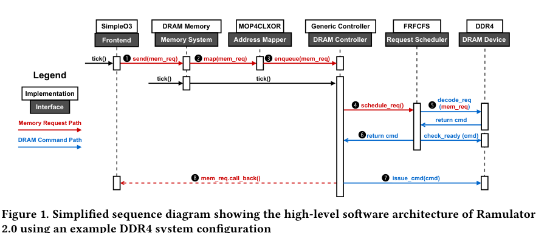

# （附加实验）Lab 5：内存请求调度

> **计算机体系结构（227-2210-00L）｜2025 年秋季**
> **授课教师：** Prof. Onur Mutlu、Dr. Mohammad Sadrosadati
> **助教（TAs）：** Dr. Konstantina Koliogeorgi、Dr. Zhiheng Yue、Rahul Bera、Konstantinos Kanellopoulos、Nika Mansouri Ghiasi、Ataberk Olgun、Nisa Bostanci、Rakesh Nadig、Ismail Emir Yuksel、Haocong Luo、Mayank Kabra、Andreas Kosmas Kakolyris、Harshita Gupta、Konstantinos Marios Sgouras、Harsh Songara、Susana Rebolledo Ruiz
> **负责答疑的助教：** Harsh Songara、Konstantinos Marios Sgouras、Haocong Luo
> **布置时间：** 2025 年 12 月 5 日（星期五）
> **截止时间：** 2026 年 1 月 3 日（星期六）午夜

## 1. 引言

本实验要求实现并评估两种内存请求调度策略：ATLAS [1] 和 BLISS [2]。为此，你将扩展 Ramulator 2 [3]（Ramulator [4] 的后继版本），在其中建模这两种内存调度策略，并评估它们对系统性能的影响。

第 2 节介绍 Ramulator 2 的基础知识，还包括一个热身任务：实现先来先服务（First-Come-First-Serve，FCFS）内存请求调度策略。第 3、4 节分别详细指导如何实现 ATLAS 和 BLISS。第 5 节说明如何评估并分析这些调度策略对系统性能的影响。请务必阅读提示及提交要求（第 7、8 节）。

## 2. 任务 1/4：熟悉 Ramulator 2（20%）

本节以分步教程的形式介绍如何：

- 构建 Ramulator 2；
- 配置并运行 Ramulator 2 仿真；
- 理解 Ramulator 2 的软件设计；
- 扩展和修改 Ramulator 2。

下文包含需要完成的**练习（Exercise）**、需要留意的**注意事项（Note）**，以及需要在实验报告中回答的**问题（Question）**。

> **练习 0/6：下载 Ramulator 2 源代码**
> 请从以下链接下载本实验使用的 Ramulator 2 版本：
> [下载 Ramulator 2 实验版](https://moodle-app2.let.ethz.ch/pluginfile.php/2463257/mod_assign/introattachment/0/ramulator2-lab.zip?forcedownload=1)

### 2.1. 构建 Ramulator 2

> **练习 1/6：解压包含 Ramulator 2 源代码的压缩包**
>
> ```bash
> tar xvzf ./ramulator2_lab.zip
> cd ramulator2_lab
> ```

> **注意 1：** Ramulator 2 的源代码组织结构如下：
>
> ```text
> ext                       # 外部库
> src                       # Ramulator 2.0 源代码
>   <component1>            # 与该组件有关的所有接口和实现的源代码
>     impl                  # 该组件所有实现的源代码
>       com_impl.cpp        # 某个具体实现的源文件
>     com_interface.h       # 定义接口的头文件
>     CMakeList.txt         # 组件级 CMake 配置
>   ...
>   CMakeList.txt           # 所有 Ramulator 2.0 源文件的顶层 CMake 配置
> CMakeList.txt             # 项目级 CMake 配置
> ```

> **注意 2：** 本实验假定使用 Linux。构建 Ramulator 2 需要：
>
> - 支持 C++20 的编译器（已使用 `g++-12` 和 `clang++-15` 测试）；
> - CMake 3.14 或更高版本。
>
> 如果没有使用 Linux，或环境不满足上述条件，可以使用已包含全部构建和运行依赖的 Docker 镜像 `richardluo831/ramulator2:latest`。首先在仓库中 `compose-dev.yaml` 所在目录执行：
>
> ```bash
> docker compose -f compose-dev.yaml up -d
> ```
>
> 随后进入 Docker 容器（将容器名称替换为实际名称）：
>
> ```bash
> docker exec -it <container name> /bin/bash
> ```

可使用以下命令构建 Ramulator 2：

> **练习 2/6：构建 Ramulator 2**
>
> ```bash
> mkdir build
> cd build
> cmake ..
> make -j4
> ```

> **注意：** 默认按上述方式构建的是 **Debug** 版本，二进制文件包含调试符号，且禁用编译器优化。完成内存请求调度机制的调试后，建议改用 **Release** 构建，以启用编译器优化、缩短仿真时间。运行 `cmake` 时添加 `-D CMAKE_BUILD_TYPE=Release` 即可。

编译成功后，`build/` 目录中应该有可执行文件 `ramulator2`。

### 2.2. 配置并运行 Ramulator 2 仿真

Ramulator 2 使用 [YAML](https://yaml.org/spec/1.2.2/)¹ 通过分层键值对指定全部配置。每个键值对指定 Ramulator 2 所建模系统中的一个组件。本实验使用的主要配置文件 `lab5_config.yaml` 位于 Ramulator 2 的根目录。

> **练习 3/6：检查本实验使用的 Ramulator 2 基线配置**
>
> ```bash
> cd ..
> less ./lab5_config.yaml
> ```

> **问题 1：** 该配置指定了什么样的内存系统？请尽可能多地列出该系统的具体规格。

从高层次看，Ramulator 2 主要由两个部分构成：**仿真前端**（配置中的 `FrontEnd` 键）和**内存系统**（配置中的 `MemorySystem` 键）。前端生成内存请求并发送到内存系统。

目前，Ramulator 2 实现了以下三类前端：

- **内存访问轨迹前端（Memory Trace Frontend）：** 读取包含应用程序主内存请求的输入轨迹文件，并依次向内存系统发送请求。由于该模式对系统的建模不够详细，无法进行充分准确的时序仿真，因此更适合测试和调试新增功能。本实验主要任务不使用该前端，但可以用它测试、调试自己的实现。当前包括两类内存轨迹前端：
  - **Load-Store Trace：** 读取带物理地址（即来自操作系统）的加载（`L`）或存储（`S`）请求。每行格式：`L/S <addr>`。
  - **Read-Write Trace：** 读取带 DRAM 地址向量（通道、Rank、Bank、行、列）的读（`R`）或写（`W`）请求。每行格式：`R/W <comma-separated addr vector>`。
- **gem5 前端（gem5 Frontend）：** [gem5](http://gem5.org) [5] 是详细建模 CPU 架构的全系统模拟器。使用这一前端可以将 Ramulator 2 接入 gem5，模拟系统的主内存部分。本实验不使用它。感兴趣的同学可访问 [gem5 官方网站](http://gem5.org)，并参阅 [Ramulator 2 与 gem5 集成资料](https://github.com/CMU-SAFARI/ramulator2)。
- **简单乱序 CPU 轨迹前端（Simple Out of Order / SimpleO3 CPU Trace Frontend）：** **本实验需要使用的前端。** 该前端建模一个带末级缓存的简化乱序处理器，支持内存指令和非内存指令两种指令类型。读取一个或多个应用程序轨迹文件，每个文件对应一个核心（例如指定四个轨迹就会模拟四核多程序工作负载）。轨迹行具有以下两种格式：
  - `<num-cpuinst> <addr-read>`：第一个字段是读请求之前的非内存指令条数，第二个字段是该读请求的内存地址。
  - `<num-cpuinst> <addr-read> <addr-writeback>`：前两个字段含义不变；第三个字段是由前述读请求引发的脏缓存行驱逐（从 L1、L2 向末级缓存写回）的地址。

内存系统一般包含以下三个组件：

- **DRAM 设备（DRAM Device）：** DRAM 的功能与时序模型。主要参数包括：
  - DRAM 的组织结构，例如每颗芯片的容量密度，以及通道、Rank、Bank、行、列的数量；
  - 时序约束，通常来自预设配置，也允许在配置中分别覆盖部分时序参数。
- **内存控制器（Memory Controller）：** 将内存请求解码成低级 DRAM 命令，依据 DRAM 功能及时序约束调度命令、完成请求。其中最重要的部件是**请求调度器**。
- **地址映射器（Address Mapper）：** 将前端提供的物理地址转换为 DRAM 地址向量（通道、Rank、Bank、行、列等）。

现在使用给定示例配置运行 Ramulator 2。标准输出（stdout）应打印日志，包括仿真结束时的统计数据。

> **练习 4/6：使用给定配置运行 Ramulator 2**
>
> ```bash
> ./ramulator -f ./lab5_config.yaml
> ```

> **问题 2：** 如何更改 SimpleO3 前端的输入轨迹文件？如何更改 Ramulator 2 将模拟的 CPU 周期数？
>
> **问题 3：** 运行四核多程序仿真：两个核心执行“L”轨迹（`low-mem-intensity.trace`），另两个核心执行“H”轨迹（`high-mem-intensity.trace`）。**提示：** 配置文件的 `traces` 键要求其值是列表。
> 比较应用程序独立运行（单核）与同其他应用程序同时运行（多核）时的每周期指令数（IPC）：二者有多大差异？简要说明原因。

### 2.3. 理解 Ramulator 2 的软件设计

Ramulator 2.0 使用**接口（Interface）**与**实现（Implementation）** 两个基础概念建模基于 DRAM 的内存系统，提升模块化程度和可扩展性。接口是在 `.h` 头文件中定义的抽象 C++ 类，从系统其他组件的视角规定组件共有的高层行为，并声明可供调用的虚函数。实现则是在 `.cpp` 中定义的具体 C++ 类，继承相应接口，提供这些虚函数的具体行为。组件通过存放在实现类中的接口指针互相交互。这种设计允许通过为相同接口创建不同实现来替换组件功能，而无需修改不相关组件的代码。

图 1 是一个简化的时序图，展示：(1) 使用 DDR4 示例配置时 Ramulator 2 的高层软件架构；(2) Ramulator 2 如何处理一个内存请求。深色方框表示接口，上方白色方框表示对应的典型实现。箭头展示组件间调用接口函数的关系；红色箭头是内存请求路径，蓝色箭头是 DRAM 命令路径。使用本实验的 SimpleO3 CPU Trace 前端时，典型仿真流程如下：

1. 前端将内存请求（缓存未命中和缓存行驱逐）发送到内存系统（①）。
2. 地址映射器把请求的物理地址转换为 DRAM 地址向量（②）。
3. 请求被插入相应 DRAM 内存控制器的队列（③）。
4. DRAM 控制器查询请求调度器，从队列里的所有请求中找出最适合处理的请求（④）。
5. 调度器根据请求类型、当前 DRAM 设备状态及其时序约束等，把内存请求解码为 DRAM 命令（⑤）。
6. 调度器按其调度策略选出最佳请求，并把相应 DRAM 命令返回控制器（⑥）。
7. DRAM 控制器发出调度后的命令，更新 DRAM 设备模型的功能状态和时序信息（⑦）。
8. 如果有请求完成，内存控制器调用其回调函数，通知前端请求已完成（⑧）。



*图 1. 使用 DDR4 示例系统配置的 Ramulator 2.0 高层软件架构简化时序图。图中保留了英文接口名，以便对照源代码。*

在 Ramulator 2 中，内存控制器中许多建模功能（例如根据已发出的 ACTIVATE 命令跟踪的 RowHammer 缓解机制）和评估辅助功能（例如从发出的 DRAM 命令采集统计数据和分析内存访问模式）都会在发出 DRAM 命令（步骤 ⑦）时触发更新。为避免针对每个功能都创建高度相似的内存控制器实现，Ramulator 2 将其作为内存控制器的**插件**建模。插件接口提供简单的 `update()` 函数，控制器通过它把所调度的请求、将要发出的 DRAM 命令和地址通知插件实现。

> **练习 5/6：实例化内存控制器插件**
> 修改配置，为 DRAM 内存控制器实例化 `TraceRecorder` 插件：
>
> ```yaml
> MemorySystem:
>   # ...
>   Controller:
>     # ...
>     plugins:
>       - ControllerPlugin:
>           impl: TraceRecorder
>           path: ./example.dram.trace
>     # ...
> ```

> **问题 4：** `TraceRecorder` 插件做什么？

### 2.4. 扩展和修改 Ramulator 2

Ramulator 2 中的接口类和实现类应遵循特定的结构。例如，名为 `ExampleInterface`、类名为 `ExampleIfce` 的接口（定义于 `example_interface.h`）应按以下形式定义：

```cpp
// example_interface.h
#ifndef RAMULATOR_EXAMPLE_INTERFACE_H
#define RAMULATOR_EXAMPLE_INTERFACE_H

// 定义 Ramulator 2 的基础数据结构和类型；所有接口都必须包含
#include "base/base.h"

namespace Ramulator {
class ExampleIfce {
  // 将 ExampleIfce 接口以名称 ExampleInterface 注册到 Ramulator 2
  RAMULATOR_REGISTER_INTERFACE(ExampleIfce, "ExampleInterface", "An example of an interface class.")
public:
  // 用虚函数建模接口的共同行为
  virtual void foo() = 0;
};
} // namespace Ramulator

#endif // RAMULATOR_EXAMPLE_INTERFACE_H
```

实现 `ExampleIfce` 的示例实现类 `ExampleImpl`，注册名称为 `ExampleImplementation`（定义于 `example_impl.cpp`），应按以下形式定义：

```cpp
// example_impl.cpp
#include <iostream>

// 实现类始终需要包含它所实现的接口头文件
#include "example_interface.h"

namespace Ramulator {
// 实现类必须同时继承所实现的接口与 Implementation 基类
class ExampleImpl : public ExampleIfce, public Implementation {
  // 将 ExampleImpl 注册为 ExampleIfce 接口的 ExampleImplementation 实现
  RAMULATOR_REGISTER_IMPLEMENTATION(ExampleIfce, ExampleImpl,
      "ExampleImplementation", "An example of an implementation class.")
public:
  // 实现具体行为
  virtual void foo() override {
    std::cout << "Bar!" << std::endl;
  };
};
} // namespace Ramulator
```

Ramulator 2 解析 YAML 配置文件时，通过上述宏所注册的名称（如 `ExampleInterface`、`ExampleImplementation`）查找接口及其实现。例如，遇到以下配置时，会自动创建一个 `ExampleImpl` 对象：

```yaml
# ...
ExampleInterface:
  impl: ExampleImplementation
# ...
```

要向 Ramulator 2 中已有接口添加新实现，只需创建包含新实现类的 `.cpp` 文件。请遵循上述示例的代码结构，包括头文件、继承关系和注册宏。**不要忘记将新 `.cpp` 文件加入 Ramulator 2 的 CMake 构建系统。**

> **练习 6/6：为 Ramulator 2 添加先来先服务（FCFS）调度器**
> 为已有 `IScheduler` 接口（定义于 `src/dram_controller/scheduler.h`）创建 FCFS 调度器实现。
> **提示：** Ramulator 2 已在 `src/dram_controller/impl/scheduler/FRFCFS.cpp` 中实现优先就绪、再先来先服务（FRFCFS）调度器。
>
> **问题 5：** FCFS 和 FRFCFS 调度器有何区别？这会如何影响系统性能？

## 3. 任务 2/4：实现 ATLAS（30%）

本任务要求扩展 Ramulator 2，实现**自适应每线程最少已获服务（Adaptive per-Thread Least-Attained-Service，ATLAS）** 调度器 [1]。ATLAS 的核心思想是周期性地根据各线程已从内存控制器获得的服务量对其排序，并在每个周期内优先处理已获服务最少的线程。正如 Kim 等人 [1] 所示，这种方法能显著减少 CPU 核心的停顿时间，从而提高系统吞吐量。

请根据 ATLAS 原始论文 [1] 的第 3—5 节，在 Ramulator 2 中实现 ATLAS 调度策略。应严格遵循论文描述的机制，但具体如何在 Ramulator 2 中实现由你决定。建议遵循 Ramulator 2 的接口—实现设计，不过实验不提供指定的软件设计，你可以选择适当的实现方式。

确保你的 ATLAS 实现与论文机制在功能上等价，并使用原论文第 6 节末尾给出的默认配置：

- **Quantum（量子）长度：** 1000 万周期；
- **α：** 0.875；
- **T：** 100K 周期。

## 4. 任务 3/4：实现 BLISS（30%）

本任务要求扩展 Ramulator 2，实现 **BLISS** 调度器 [2]。BLISS 的核心思想是将应用程序划分为两个组：内存访问强度较高的应用和访问内存较少的应用。BLISS 通过识别连续多次访问同一行的应用程序，并在一段指定时间内降低它们的优先级，来实现这种划分。正如 Subramanian 等人 [2] 所示，BLISS 可减少两组之间的相互干扰，从而提高系统吞吐量和公平性。

请根据 BLISS 原始论文 [2] 的第 4—5 节，在 Ramulator 2 中实现 BLISS 调度策略。与任务 2 一样，没有指定的软件实现方式，可自行设计。

确保 BLISS 实现与论文机制在功能上等价，并使用论文第 6.5 节末尾的默认参数：

- **黑名单阈值（Blacklisting Threshold）：** 4；
- **清除间隔（Clearing Interval）：** 10K 周期。

## 5. 任务 4/4：评估 ATLAS、BLISS 并与传统内存调度策略比较（20%）

现在需要将实现的 ATLAS 与 BLISS 和基线调度策略（FCFS、FRFCFS）进行比较，评估它们带来的**指令吞吐量（Instruction Throughput，IT）**与**最大减速比（Maximum Slowdown，MS）**。使用如下定义：

\[
\mathrm{IT}=\frac{\displaystyle\sum_{c=0}^{\mathrm{NumCores}}\mathrm{InstructionsRetired}(c)}{\mathrm{CPUCycles}}
\]

即所有核心退休的指令数之和除以仿真完成时经历的总 CPU 周期数。

\[
\mathrm{MS}=\max_{a\in\mathrm{Applications}}
\frac{\mathrm{CPUCycles}_{\mathrm{shared}}(a)}{\mathrm{CPUCycles}_{\mathrm{alone}}(a)}
\]

计算单个应用的减速比时，用该应用与其他应用共同运行时的执行时间，除以其在相同系统上独立运行时的执行时间。**最大减速比（MS）**是某个多程序工作负载中所有应用减速比的最大值。

首先，需要在 Ramulator 2 的统计项中添加**指令吞吐量**，使标准输出的统计信息中包含新条目。必须按上述公式计算 IT。**提示：** 参考已有统计项是如何向标准输出打印的。

由于计算 MS 需要使用不同配置多次运行 Ramulator 2（所有应用共同运行，以及目标应用单独运行），因此无法直接将 MS 加入单次运行的统计项。你需要**手动计算 MS**，或编写脚本读取多次 Ramulator 2 运行输出的统计数据，并计算各配置的 MS。

进行仿真时须遵循：

1. 除本实验明确允许修改的内容之外，**不得更改处理器或内存配置的其他部分**。
2. 运行仿真，直到**每个核心退休 2000 万条指令**。
3. 对每种调度策略，运行以下多程序工作负载：
   - **工作负载 1：** HLLL（四核）；
   - **工作负载 2：** HHLL（四核）；
   - **工作负载 3：** HHHH（四核）；
   - **工作负载 4：** HHHHHHHH（八核）。

其中 **H** 代表高内存访问强度轨迹的一个实例，**L** 代表低内存访问强度轨迹的一个实例。两种轨迹均由课程提供（见第 2.1 节）。

使用以下内存调度器运行 Ramulator 2，收集 IT 和 MS，并分析结果：

- **FCFS（First-Come-First-Serve）：** 请求队列中最先插入的内存请求最先得到服务。
- **FRFCFS（First-Ready-First-Come-First-Serve）：** 与 FCFS 类似，但优先处理请求队列中访问已打开 DRAM 行的请求。
- **ATLAS：** 你根据文献 [1] 实现的调度器。
- **BLISS：** 你根据文献 [2] 实现的调度器。

对每个工作负载分别使用上述全部调度策略进行评估。收集指令吞吐量（IT）与最大减速比（MS）并合理绘图。**IT 和 MS 应分别绘图**，图中需要覆盖四种调度策略和四个多程序工作负载。

在实验报告中回答：

1. 提供两张图，一张展示 IT，一张展示 MS；每张图都应包含四种工作负载与四种调度策略。
2. 解释两张图。
3. 使用不同调度策略时，吞吐量和 MS 分别如何变化？解释原因。
4. 结果是否符合预期？明确说明你预期各调度策略产生何种差异。如果结果不符合预期，分析为什么没有观察到预期效果。

## 6. 附加任务：设计自己的内存调度器

本任务要求提出一个或多个新的内存调度思想，希望其性能优于现有调度策略。你可以阅读更多相关文献，深入研究已有工作，也可以充分发挥创造力和洞察力。只要是自己提出的想法，具体设计不受限制。

采用与任务 4 中评估 ATLAS 和 BLISS 相似的方式评估新策略，并与前述四种调度策略逐一比较。

提交：(1) 新想法的详细描述，(2) 基于 Ramulator 2 的实现，(3) 新策略的评估结果。可以使用与任务 4 相似的图表。

如果提出的优秀调度方案优于本实验提及的现有调度方案，可获得**整门课程成绩的 1.5%** 的奖励；特别有创造性或有见解的想法也可能获得加分。

## 7. 提示

- **请不要传播课程提供的程序文件。** 这些文件仅供计算机体系结构课程的每名学生个人使用。传播和分享会侵犯所提供软件的版权。
- 仔细阅读本实验说明。
- 如有需要，在 Moodle 的在线问答论坛向助教提问。
- 遇到技术问题时，先仔细阅读错误信息；网上搜索通常能解决许多调试问题与报错。

## 8. 提交要求

请通过 Moodle 中[对应的实验提交页面](https://moodle-app2.let.ethz.ch/mod/assign/view.php?id=1314502)提交以下内容：

- 编译代码所需的全部文件（**包括未修改的 Ramulator 2 源文件**）。
- **一份 PDF 报告**，包含三个主要部分：(1) 对任务 1 所有问题的回答；(2) 对在 Ramulator 2 中实现新调度策略所作更改的简要说明；(3) 第 5 节相关分析及绘图结果。
- 与分析相关的所有 Ramulator 2 **标准输出**。
- **不要**提交 Moodle 提供的轨迹文件。
- **不要**提交编译产生的文件，例如 Ramulator 2 可执行文件、`.obj` 文件等。

请将以上文件打包在同一个 tarball 中，命名为：

```text
lab5_<YourSurname><YourName>.tar.gz
```

## 参考文献

[1] Yoongu Kim, Dongsu Han, Onur Mutlu, Mor Harchol-Balter. *ATLAS: A Scalable and High-Performance Scheduling Algorithm for Multiple Memory Controllers*. HPCA, 2010.

[2] Lavanya Subramanian, Donghyuk Lee, Vivek Seshadri, Harsha Rastogi, Onur Mutlu. *BLISS: Balancing Performance, Fairness and Complexity in Memory Access Scheduling*. TPDS, 2016.

[3] Haocong Luo, Yahya Can Tuğrul, F. Nisa Bostancı, Ataberk Olgun, A. Giray Yağlıkçı, Onur Mutlu. *Ramulator 2.0: A Modern, Modular, and Extensible DRAM Simulator*. arXiv:2308.11030 [cs.AR], 2023.

[4] Yoongu Kim, Weikun Yang, Onur Mutlu. *Ramulator: A Fast and Extensible DRAM Simulator*. CAL, 2015.

[5] Nathan Binkert, Bradford Beckmann, Gabriel Black, Steven K. Reinhardt, Ali Saidi, Arkaprava Basu, Joel Hestness, Derek R. Hower, Tushar Krishna, Somayeh Sardashti, et al. *The gem5 Simulator*. ACM SIGARCH.

---

¹ YAML 标准：https://yaml.org/spec/1.2.2/


