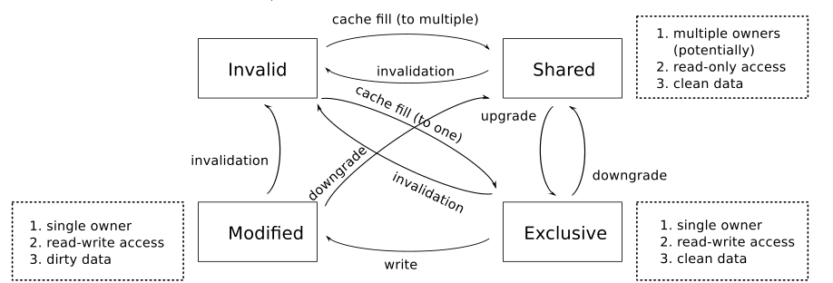
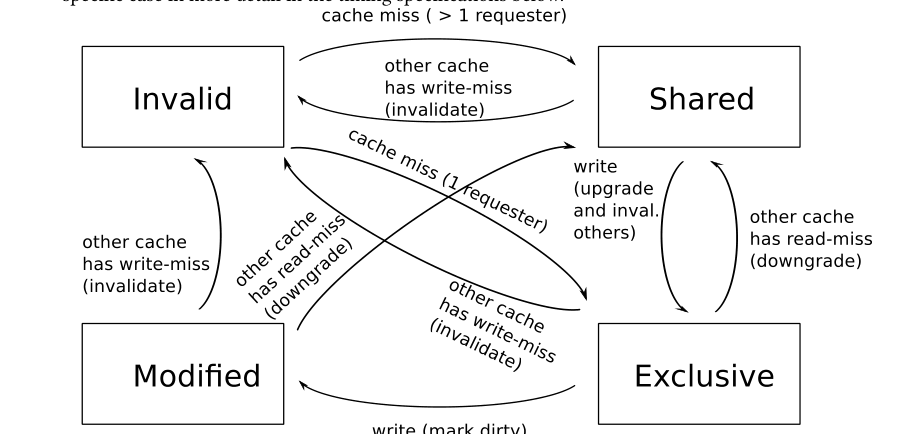

# Lab 7：多核与缓存一致性（附加实验）

> **计算机体系结构（227-2210-00L）｜2025 年秋季**
> **授课教师：** Prof. Onur Mutlu、Dr. Mohammad Sadrosadati
> **助教（TAs）：** Dr. Konstantina Koliogeorgi、Dr. Zhiheng Yue、Rahul Bera、Konstantinos Kanellopoulos、Nika Mansouri Ghiasi、Ataberk Olgun、Nisa Bostanci、Rakesh Nadig、Ismail Emir Yuksel、Haocong Luo、Mayank Kabra、Andreas Kosmas Kakolyris、Harshita Gupta、Konstantinos Marios Sgouras、Harsh Songara、Susana Rebolledo Ruiz
> **负责答疑的助教：** Nika Mansouri Ghiasi、Nisa Bostanci
> **布置日期：** 2025 年 12 月 23 日（星期二）
> **截止日期：** 2026 年 1 月 19 日（星期一）23:59

## 1. 实验目标

本实验需要扩展 Lab 2 中开发的模拟器，使其能够模拟一个具有**缓存一致性存储层次结构**的多核系统。本文将介绍缓存一致性协议的运行方式，以及为了支持多线程，需要如何修改模拟器的功能接口。

## 2. 多核：功能方面的变化

在建模多核系统的微体系结构细节之前，需要扩展系统的功能接口，使用户程序能够使用多线程。本实验对功能（ISA 级）接口进行如下修改：

- **四个 CPU，共享内存：** 系统包含 4 个 CPU，编号为 CPU 0 至 CPU 3。每个 CPU 都有私有的架构状态（寄存器文件和程序计数器），但它们共享内存。因此，如果 CPU 0 向地址 `0x10000000` 写入某个值，CPU 1 随后从同一地址读取，就必须读到 CPU 0 写入的值。
- **独立的 CPU 与共享的存储层次结构：** 除共享的存储层次结构（L2 缓存、L2 MSHR、DRAM 子系统）之外，各 CPU 彼此独立。每个 CPU 都应拥有自己的流水线、分支预测器与 L1 缓存。
- **初始执行状态：** 开始时仅 CPU 0 运行。因此，单线程程序的行为应与先前实验中 MIPS 实现执行该程序时完全相同。
- **创建线程的新系统调用：** 为在另一个 CPU 上启动线程，本实验定义了新的系统调用。当执行 `SYSCALL` 且 `$v0 = 1`、`2` 或 `3` 时，分别在 CPU 1、2 或 3 上启动新线程。启动时，目标 CPU 的 PC 设置为 `SYSCALL` 下一条指令的地址（`PC + 4`），目标 CPU 的 `$v1` 设置为 `1`；发起 `SYSCALL` 的 CPU 的 `$v1` 设置为 `0`。因此，从程序角度看，系统调用之后原线程和新线程都会继续执行，借助 `$v1` 的值区分新旧线程。¹ 新线程从**下一个周期**开始执行。测试只会包含目标 CPU 当前不在执行、流水线中没有指令的线程创建情况。
- **新控制台输出系统调用：** 当 `SYSCALL` 的 `$v0 = 11` 时，模拟器将 `$v1` 的值作为系统调用参数，并在标准输出打印一行，例如：

  ```text
  OUT (CPU 2): 1234fffe
  ```
- **程序终止系统调用：** 当 `$v0 = 10` 时，现在只停止**当前 CPU**，整个仿真直到**所有 CPU 均停止**才结束。

¹ 这是 Unix `fork()` 系统调用的一个简化版本。

## 3. 模拟器 Shell 的变化

在本实验中，你需要修改 Shell。与以前的实验不同，现在**允许修改 `shell.c` 和 `shell.h`**。为方便评分，本文精确规定模拟器必须产生的输出。**提交的模拟器不得输出调试信息；任何额外输出都会视为错误结果。**

除下列指定输出外，模拟器不得向标准输出打印任何内容（这意味着必须删除 Shell 欢迎语与命令提示符）。

模拟器只需要支持以下命令：

- **`go`：** 一直执行，直到所有 CPU 停止。只有执行控制台输出系统调用时才允许产生输出。
- **`run N`：** 运行 `N` 个周期。与上面相同，只打印控制台输出。如果执行在 `N` 个周期内完成，则应提前停止。
- **`i X Y`：** 将 CPU 0 的寄存器 `X` 设置为数值 `Y`。
- **`rdump`：** 输出全部 4 个 CPU 的寄存器状态。对每个 CPU，先打印一行 `CPU n:`，再打印 `PC: 0x01abcdef`、`R0: 0x00000000` 一直到 `R31: 0xdeadbeef`、`HI: 0x00000000` 和 `LO: 0x00000000`（将示例数值替换为实际值）。在输出四个 CPU 的寄存器之后，应再打印一行 `Cycles: n`。**不得有空行。**

注意：`go`、`run` 和 `i` 的功能与以前相同；只有 `rdump` 需要修改为输出所有 CPU 的状态。

当标准输入遇到 EOF 时，模拟器应直接退出，不再打印其他内容。

## 4. 缓存一致性概述

多个 CPU 共享同一存储层次结构，但各自拥有私有的 L1 数据缓存和指令缓存时，如果某个缓存块在多个 CPU 的缓存中有副本，而其中一个副本被修改，就可能产生不正确的执行结果。

例如，CPU 0 和 CPU 1 的 L1 数据缓存中都有数据块 X 的副本。最初这些副本都来自它们共享的 L2 缓存，因此内容相同。两者读取块 X 时不会出错。但是，如果 CPU 0 执行存储指令修改块 X 中的值，而 CPU 1 随后从块 X 加载数据，就必须看到修改后的新值。因此，新值必须以某种方式传播到 CPU 1 可见的地方。这就是**缓存一致性问题（cache coherence problem）**。规定多个缓存如何交互、以解决该问题的一组规则称为**缓存一致性协议**。

实现缓存一致性的方式有多种。本实验关注一种常见方法：**基于失效的缓存一致性协议（invalidation-based cache coherence protocol）**。当某个 CPU 请求写入缓存块时，该协议要求使所有其他 CPU 缓存中保存该块的副本失效（删除）。这样，请求方 CPU 就成为该缓存块副本的唯一持有者，可以修改其中的数据。如果稍后其他 CPU 试图读取该块，就会发生缓存未命中，必须向先前修改数据的 CPU 获取新数据。具体交互方法将在后文说明。

通过在必要时使缓存块失效，基于失效的协议强制维持以下**不变量**，确保所有 CPU 都看到正确值：

> **基于失效协议的不变量：** 对任意缓存块 X，要么它最多只存在于一个缓存中且处于可写状态，要么它可以存在于多个缓存中，但这些副本只能处于只读状态。

本实验将实现一个简化版 **MESI 缓存一致性协议**，也称 Illinois 协议 [2]。MESI 是一种基于失效的协议，其名称来自 L1 缓存块可能具有的四种状态：Modified、Exclusive、Shared、Invalid。

- **Modified（M，已修改）：** 相对于共享存储层次结构，该块为脏数据。在所有实现 MESI 的缓存中，这是此数据的唯一副本，持有该块的 CPU 可自由继续修改。
- **Exclusive（E，独占）：** 相对于共享存储层次结构，该块是干净的，但它仍是所有 MESI 缓存中的唯一副本。因此，持有方 CPU 要写入该块时，无需咨询其他 CPU，就能将其转为 Modified。
- **Shared（S，共享）：** 相对于共享存储层次结构，该块是干净的，而且不能保证它是唯一副本，因此该块只能读取。CPU 可以读取 Shared 状态的块；若需要写入，则必须按后文说明先转换为 Exclusive 状态。
- **Invalid（I，无效）：** 表示对应缓存块未存在于该缓存中。

由于多个缓存可以同时以 Shared 状态保存同一块，因此 Shared 也称**多所有者状态**。相反，Exclusive 与 Modified 有时称为**单所有者状态**，因为某个缓存以这两种状态持有某块时，其他缓存都不能持有该块。

下图展示一个缓存块在 Modified、Exclusive、Shared、Invalid 四种状态之间的转换。时序规范章节将给出具体转换流程；该图只从较高层次展示转换及其名称。**注意，状态图仅描述一个缓存中的一个块**；其他 CPU 的缓存可处于不同状态，例如 X 在 CPU 0 中为 Modified，而在 CPU 1 中为 Invalid。



*MESI 状态图（原文第 3 页）。常用转换：`upgrade` 升级、`downgrade` 降级、`invalidation` 失效、`cache fill` 缓存填充。*

一些常见状态转换具有专门名称：

- **升级（upgrade）：** 从 Shared 转为单所有者状态（Exclusive 或 Modified）。因为此转换授予持有方缓存对数据块的写权限，所以称为升级。
- **降级（downgrade）：** 从单所有者状态（Exclusive 或 Modified）转为 Shared。这会收回持有方修改数据的权利，换来多个缓存共享副本的能力。
- **失效（invalidation）：** 从 Modified、Exclusive 或 Shared 转为 Invalid。此转换允许另一缓存进入单所有者状态，使相应 CPU 可以修改数据。

下图概览上述转换发生的情形。除非特别写明“其他缓存”（other cache），这些转换都从单个缓存的视角描述。时序规范部分还会详细说明每种情况。



*MESI 转换情形概览（原文第 4 页）。`read-miss` 为读未命中，`write-miss` 为写未命中，`inval.` 为使其他副本失效。*

如需深入学习缓存一致性，请观看 Mutlu 教授关于该主题的课程视频 [1]。

## 5. 时序规范：具备缓存一致性的存储层次结构

你需要在 **Lab 2 模拟器**的基础上，以**周期精确（cycle-accurate）**的方式实现以下行为。除非本实验明确覆盖之前的某项规定，否则 **Lab 1 和 Lab 2 的所有规范仍然适用**。

- **CPU 仿真顺序：** 按 CPU 编号升序（CPU 0、CPU 1、CPU 2、CPU 3）逐周期模拟。即先模拟 CPU 0 的周期 0，再模拟 CPU 1 的周期 0，依此类推。同一周期两个或多个 CPU 的操作发生竞争时，除特别规定外按此顺序决定优先级。所有 CPU 各模拟完一个周期后，再模拟存储系统的一个周期。
- **同周期事件：** 在本实验中，同一个缓存可能在同一个周期内发生多个事件，其逻辑顺序由前述规则规定。在建模 LRU 替换策略时，必须正确处理这种情况。
- **分支恢复：** 为简化实现，分支恢复现在**不会取消因指令缓存未命中而产生的流水线停顿**。缓存一致性本身已经足够复杂，无须再回滚取消请求的副作用。
- **SYSCALL 使流水线串行化：** 为确保系统调用的正确性，`SYSCALL` 必须独占流水线执行：

  - 若 `SYSCALL` 处于译码阶段，而后续阶段（执行、访存、写回）仍有指令，则 `SYSCALL` 必须停在译码阶段。
  - 若 `SYSCALL` 处于执行、访存或写回阶段，则译码阶段中的任何指令都必须等待，直到 `SYSCALL` 离开流水线。
  - 系统调用的动作在 `SYSCALL` 到达**写回阶段**时生效。

  **为什么需要串行化：** 流水线 CPU 通常通过在固定阶段处理资源（例如存储与加载都按程序顺序在访存阶段执行）或实现完整旁路（例如寄存器数据依赖）来保证程序顺序。但系统调用可能产生不明显的依赖关系，因为它会执行系统中的“特殊”动作。例如线程终止时，流水线中所有位于终止系统调用之后的指令都必须撤销。之前的实验也许针对这一情况进行过修复；现在系统调用种类更多，要求 `SYSCALL` 独占流水线是一种更简洁的正确性保障。
- **L2 缓存：** 参数与 Lab 2 相同，但现在**每个块都具有一个脏位**。
- **L1 指令与数据缓存：** 参数与前几次实验相同，但现在必须实现 MESI 一致性协议。为此，每个缓存块包含 **2 位 MESI 状态**，可表示 Modified、Exclusive、Shared、Invalid：

  - 块处于 **Modified** 或 **Exclusive** 时，加载和存储都命中；对 Exclusive 块执行存储时，状态更新为 Modified。
  - 块处于 **Shared** 时，加载命中，存储则产生**升级未命中（upgrade miss）**。
  - 所有其他访问都未命中。
- **L1 MSHR：** 每个 L1 缓存现在都具有一个 MSHR，用于记录它当前尚未完成的请求（如果有）。MSHR 中应保存请求块、请求类型（读／加载或写／存储），以及数据将在哪个周期准备就绪。

### 5.1. 缓存未命中的处理流程

缓存未命中可能是因为向 Shared 块写入触发升级，也可能只是请求的数据不在缓存中。缓存控制器必须在未命中发生的那个周期执行以下流程。**为简化协议，下面各步骤在未命中时立即完成**（与 Lab 2 不同）；若给步骤之间增加延迟，就需要处理更多中间转换状态，一致性协议会复杂得多。

1. **步骤 1：写入互斥（Write Exclusion）**如果其他任何 L1 缓存存在对同一块尚未完成的写入（由 MSHR 状态判断），或者此次访问是写入且其他 L1 缓存存在对该块尚未完成的读取，则本次访问必须停顿；下一个周期从步骤 1 重新开始。（真实缓存层次结构一般没有这条规则；本实验用它减少边界情况、简化实现。）
2. **步骤 2：检查活动 MSHR（Check Active MSHRs）**控制器扫描所有有效 L2 MSHR，判断是否已经有对同一块正在进行的未命中请求。如果有，本次未命中直接停顿（已有请求最终会返回数据，届时也满足本次未命中）；否则进入步骤 3。
3. **步骤 3：确保 MSHR 可用（Ensure MSHR is Available）**此时，本次请求是针对没有其他未完成请求的新块的 L1 未命中。如果没有空闲 L2 MSHR，则此次访问必须停顿，并于下一周期从步骤 1 重新执行。由于 L2 MSHR **仅在 L2 未命中时才需要**，这里暂时不分配 MSHR。提前检查可以避免之后在步骤 5 确认 L2 未命中、却发现没有可用 MSHR 时，不得不回滚已经部分更新的状态。
4. **步骤 4：探测其他 L1 缓存（Probe Other L1 Caches）**探测所有其他 L1 缓存。假定所有缓存都有足够端口，允许同一周期发生任意数量的探测。如果其他 L1 缓存中存在该块，则根据本次请求是读还是写，执行步骤 4a 或 4b。

   - **步骤 4a：在其他 L1 中找到，且本次为读（Found in Other L1, Read）**如果其他缓存中有目标块，并且本次请求是读取，则控制器将其他所有保存该块的缓存中的状态**降级为 Shared**，并更新这些缓存中的 LRU 顺序。然后，将数据以 Shared 状态插入请求方 CPU 的 L1 缓存。如果其他 L1 中被降级的块此前是 **Modified**，则按以下方式执行到 L2 的写回：

     - 如果该块存在于 L2，则设置它的脏位并更新 L2 中的 LRU 顺序（因为此次写回访问了该块）。
     - 如果 L2 中不存在该块，则**不向 L2 写回**。真实系统中，这种写回可能导致 L2 未命中和驱逐，但本实验为简化省略这些行为；相反，在**同一周期直接将脏块写入主内存**，且不更新 L2。
     - 接着执行步骤 4c。
   - **步骤 4b：在其他 L1 中找到，且本次为写（Found in Other L1, Write）**如果其他缓存中存在所请求的块，并且本次是写入，则控制器使其他所有保存该块的 L1 副本**失效**，再将数据插入请求方 CPU 的 L1 缓存。如果其他 L1 中找到的块原来为 Modified，则在请求方 L1 中也以 Modified 状态插入（脏数据直接转移，无须写回 L2）。否则，该块先以 Exclusive 状态插入，再因本次写入立即转为 Modified。接着执行步骤 4c。
   - **步骤 4c：L1 写回（L1 Writeback）**
     在步骤 4a 或 4b 将目标块插入请求方 L1 时，若因此驱逐了另一缓存块，且被驱逐块处于 Modified 状态，则按步骤 4a 所述方法处理 L1 到 L2 的写回。

   **如果缓存未命中在步骤 4 被满足，那么此次未命中需要 5 个周期完成。**
5. **步骤 5：探测 L2 缓存（Probe L2 Cache）**如果请求尚未得到满足，则探测 L2。如果数据存在于 L2，控制器更新 L2 中该块的 LRU 顺序，然后把块插入请求方 CPU 的 L1。由写入（存储）引起的请求以 **Modified** 状态插入；由读取（加载）引起的请求以 **Exclusive** 状态插入。若 L1 插入驱逐了其他块，按步骤 4a 处理写回。**如果未命中在步骤 5 得到满足，此次未命中需要 15 个周期完成。**
6. **步骤 6：访问主内存（Go to Memory）**
   此时控制器确定该请求发生 L2 未命中，必须从主内存读取数据。分配一个 L2 MSHR，之后按照 Lab 2 的规范处理内存请求，即经过 **5 个周期的传输延迟**后，请求进入内存请求队列。

### 5.2. 内存请求完成后的缓存填充流程

每当内存请求完成、数据在 L2 控制器处准备就绪时（请求完成之后 5 个周期；原文此处写“按 Lab 4 的规定”），执行以下缓存填充步骤：

1. **步骤 1：插入 L2（L2 Insertion）**将请求地址对应的缓存块插入 L2。对于这次插入从 L2 驱逐的缓存块，**不执行任何写回处理**。
2. **步骤 2：插入 L1（L1 Insertion）**控制器扫描全部 L1 MSHR。对每个正等待该返回缓存块的 L1 MSHR，都将新块插入相应的 L1 缓存。新块的状态如下：

   - 若尚未完成的请求是**写（store）**，状态为 **Modified**；
   - 若是**读（load）**，且该请求是此地址的**唯一未完成请求**，状态为 **Exclusive**；
   - 其他情况为 **Shared**。

   若新块插入 L1 时驱逐了另一个块，则按照步骤 4a 处理该块的写回。
3. **步骤 3：释放 MSHR（Free MSHR）**控制器释放与此内存请求关联的 L2 MSHR。
4. **步骤 4：完成 L1 请求（Complete L1 Request）**
   将新块插入某个 L1 缓存后，该 L1 缓存要再等待 **5 个周期**才能解除停顿。因此，在主内存请求完成后的 **10 个周期**，流水线可以继续使用缓存未命中返回的值。L1 解除停顿时，释放对应的 L1 MSHR。

## 6. 开始实验

**本实验没有单独提供的实验目录。** 请从你已正确实现的 Lab 2 模拟器出发，对它进行扩展，以支持上述系统模型。

允许修改模拟器源码中的**任何文件**，也可添加新文件。由于本实验已经规定对外的程序接口，因此对源文件的修改方式不再施加限制。

## 7. 提示

- **请勿传播课程提供的程序文件。** 这些文件仅供计算机体系结构课程的每位学生个人使用，传播和共享会侵犯软件版权。
- 如有需要，可通过 [Moodle 在线问答论坛](https://moodle-app2.let.ethz.ch/mod/moodleoverflow/view.php?id=1320450) 向助教提问。
- 遇到技术问题时先阅读错误信息；网络搜索通常能够解决许多调试问题。

## 8. 提交要求

通过 [Moodle 对应的实验提交页面](https://moodle-app2.let.ethz.ch/mod/assign/view.php?id=1320451)，将编译与仿真代码所需的**全部文件**打包为一个 tarball 提交，名称为：

```text
lab7_<YourSurname><YourName>.tar.gz
```

请在模拟器代码中加入注释，解释你所进行的修改。

## 9. 评分

与以前的实验相同，本实验将根据一组**不会提前发布的测试**进行客观评分。模拟器必须在功能上正确，达到单线程运行情况下应有的正确性。同时，模拟器必须严格符合本文规定的时序行为。评分方可自行决定对“接近正确”的结果给予一定部分分数，具体尺度另行确定。

## 10. 参考时序结果

下方列出了几个参考测试的时序结果。评分可能采用许多其他测试，你的时序结果同样需要正确匹配。列出这些结果仅为方便调试和验证实现是否满足时序规范。

**这些测试并不全面。** 应额外编写测试以覆盖系统各个方面，并逐周期检查行为，确保实现满足本文全部规定。

在[课程实验 Materials 页面](https://safari.ethz.ch/architecture/fall2025/doku.php?id=labs)中，提供了更新后的测试集合，包含下表所有测试。

| 基准测试名称                | 周期数（Cycles） | 预期输出（Expected Output） |
| --------------------------- | ---------------: | --------------------------- |
| `thread_tests/parmatmult` |      `8546075` | `OUT (CPU 0): 7f0c0000`   |
| `thread_tests/test1`      |          `833` | 见下方输出 1                |
| `thread_tests/test2`      |         `1463` | 见下方输出 2                |
| `long_tests/primes`       |      `2448549` | 无输出                      |
| `long_tests/fibonacci`    |      `5243441` | 无输出                      |
| `cache_tests/test1`       |      `1751621` | 无输出                      |

**输出 1：`thread_tests/test1`**

```text
OUT (CPU 0): 00000000
OUT (CPU 1): 00000001
OUT (CPU 2): 00000002
OUT (CPU 3): 00000003
```

**输出 2：`thread_tests/test2`**

```text
OUT (CPU 0): 00000001
OUT (CPU 1): 00000001
OUT (CPU 2): 00000001
OUT (CPU 3): 00000001
```

## 参考文献

[1] Onur Mutlu. *Computer Architecture – Lecture 21c: Cache Coherence (Fall 2025)*. [YouTube 课程视频](http://www.youtube.com/watch?v=T2LxWfefhsc).

[2] M. Papamarcos and J. Patel. *A Low-Overhead Coherence Solution for Multiprocessors with Private Cache Memories*. ISCA-11, 1984.

---

> **翻译说明：** 保留原文的规则次序、关键时序数字、状态定义、输出示例、参考测试及链接。MESI 状态图及事件图保留英文原图，图注和正文均给出中文解释。原文第 6 页的缓存填充描述引用了“Lab 4”，此处按原文翻译；先前有关存储层次结构的规则由 Lab 2 定义。
