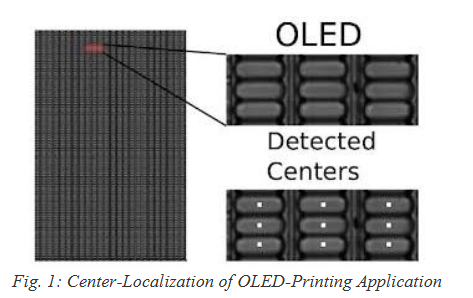
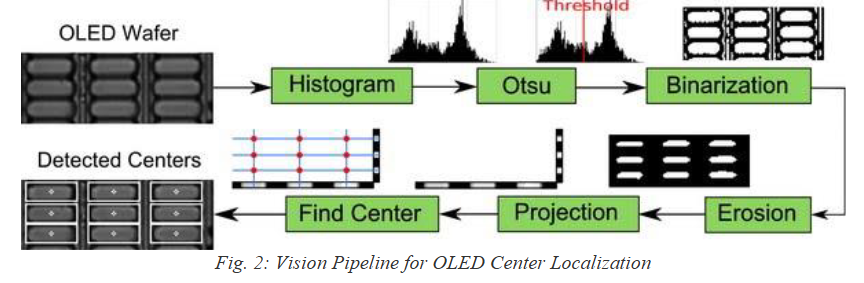

# COEN-4730 计算机架构

# HW 6

马凯特大学 电气与计算机工程系

*Cristinel Ababei*

## 1. 目标

学习在 CMP 上开发并行应用程序。通过 GEM5 全系统模拟器和 McPAT 功耗计算器模拟验证这些应用。

## 2. 背景

最先进的 CPU 在单个芯片上包含几十个核。这些新体系结构给计算机架构师和程序员都带来了新的挑战。本作业中，我们将尝试应对其中一些挑战。在了解了主流多核 CPU 体系结构之后，本作业的目的是学习如何在这些体系结构上开发并行应用，以及如何在真实环境中分析性能。

本作业中，你将把一个 C 程序映射到一个多处理器系统上。借助 GEM5 全系统模拟器和 McPAT 功耗建模框架，我们将考察不同的配置（例如处理器个数、不同缓存级的块大小和相联度等）。目标是优化系统的**能耗延迟面积积（EDAP）**。你可以通过改进原始 C 代码、使用 OpenMP，和/或使用任何其他创造性方法来实现这一目标。

我们使用 OpenMP 创建一个并行应用。我们使用 GEM5 模拟器和 McPAT 功耗建模框架来探索不同体系结构配置的效果。

### OpenMP

OpenMP（Open Multi-Processing，[http://openmp.org](http://openmp.org)）是一个 API，支持在大多数处理器体系结构和操作系统上，用 C、C++ 和 Fortran 进行多平台共享存储多处理编程。在 C 和 C++ 中，程序员可以用 **pragma** 注解来告诉编译器如何并行化应用程序。例如，下面这段代码用支持 OpenMP 的编译器编译：

```c
int main(int argc, char* argv[]) {
    const int N = 100000;
    int i, a[N];
    #pragma omp parallel for
    for (i = 0; i < N; i++)
        a[i] = 2 * i;

    return 0;
}
```

在多核平台上，这个 **for** 循环将在多个线程上执行。默认情况下，OpenMP 使用的线程数等于系统中的核数。

下面是一些学习 OpenMP 更多知识的链接：

- OpenMP 资源页面：
  [https://www.openmp.org/resources/](https://www.openmp.org/resources/)
- Ruud van der Pas 所著 "An Overview of OpenMP"：
  [https://www.openmp.org/wp-content/uploads/ntu-vanderpas.pdf](https://www.openmp.org/wp-content/uploads/ntu-vanderpas.pdf)
- "Hands-On Introduction to OpenMP" 及代码练习：
  [https://www.openmp.org/wp-content/uploads/hands-on-SC08.pdf](https://www.openmp.org/wp-content/uploads/hands-on-SC08.pdf)
  [https://www.openmp.org/wp-content/uploads/OMP_Exercises.zip](https://www.openmp.org/wp-content/uploads/OMP_Exercises.zip)
- 维基百科：
  [https://en.wikipedia.org/wiki/OpenMP](https://en.wikipedia.org/wiki/OpenMP)

> **注意：OpenMP 并不是（完全）自动并行化！** 虽然 OpenMP 编译器自动完成了并行化过程的一部分，但一个重要的方面是：编译器并不检查（当然也不证明）并行化应用的正确性。所以，如何正确地给代码加注解，很大程度上要靠程序员自己。

## 3. 环境搭建

### GEM5 和 McPAT

你应该已经在前面作业的工作中安装好了这些工具。

### ALPHA

你应该已经具备了做本作业 ALPHA 部分所需的几乎一切。

- **交叉编译器 ALPHA**：你唯一还需要的是一个 ALPHA 预编译交叉编译器。它包含在本作业提供的文件中：`alphaev7-unknown-linux-gnu.tar.bz2`（注意：它是 gem5 下载网站上的 "gcc-4.3.2, glibc-2.6.1 (NPTL,x86_64)"）。
  把它放到你在 gem5 内创建的一个新文件夹里，然后解压：

  ```
  > mkdir cross_compilers
  > cd cross_compilers
  （把提供的文件复制到这里，然后解压）
  > tar -vxjf alphaev7-unknown-linux-gnu.tar.bz2
  并设置权限：
  > chmod 777 *
  ```

### ARM

本作业的 ARM 部分，你需要下载并解压一个合适的磁盘镜像和二进制。更具体地，我们将使用 `aarch-system-2014-10.tar.xz`，它包含在本作业提供的文件中（也可以在以下位置获得）：

[https://www.gem5.org/documentation/general_docs/fullsystem/guest_binaries](https://www.gem5.org/documentation/general_docs/fullsystem/guest_binaries)

在 gem5 文件夹内的 `full_system_images_ARM/` 文件夹中解压它：

```
> cd full_system_images_ARM
> tar xvf aarch-system-2014-10.tar.xz
```

你还需要编译一个 **ARM 版本**的 gem5 模拟器。首先，添加 `M5_PATH` 环境变量：

```
> cd
> emacs .bashrc
```

在末尾添加下面这一行：

```
export M5_PATH=/home/cristinel/hw4/gem5/full_system_images_ARM
> source .bashrc
```

然后，让我们构建带 ARM 支持、开启优化的 FS 模式 gem5 模拟器：

```
> cd /home/cristinel/hw4/gem5
> scons FULL_SYSTEM=1 build/ARM/gem5.opt
```

这可能要花好几分钟才能完成；所以耐心点。

- **交叉编译器 ARM**：我们需要为 ARM 体系结构安装一个合适的交叉编译器。在终端中执行：

  ```
  > sudo apt-get install gcc-arm-linux-gnueabi
  ```

  如果上面出现与未满足依赖相关的错误，执行以下步骤：

  ```
  > sudo apt-get remove binutils-common
  > sudo apt-get install binutils-common
  > sudo apt-get install binutils-arm-linux-gnueabi
  > sudo apt-get install gcc-7-arm-linux-gnueabi
  > sudo apt-get install gcc-arm-linux-gnueabi
  ```

## 4. 作业内容

你需要把一个应用映射到一个 4 核多核处理器上，针对两种不同 ISA：ARM 和 ALPHA，并用 GEM5 模拟。目标是为给定应用优化能耗延迟面积积（EDAP）。应用在下一节描述。所有源文件都在 D2L 上的归档包中提供。把 `gem5/benchmarks/` 中提供的文件复制一份。

然后，花点时间做以下事情：

1) 先阅读 OpenMP 的资料。
2) 研究给定应用的源代码（所有 `.c` 和 `.h` 文件）。
3) 对每种 ISA（ARM 和 ALPHA），核数取 4，并使用你在前面 HW#5 中找到的最佳体系结构，迭代：
   a) 修改该应用的源代码，用 OpenMP 将其并行化。发挥你的创造力来改写它，使其尽可能并行。你的目标是让应用在该体系结构上跑得更快。
   b) 编译并用 GEM5 运行该应用。把 GEM5 的输出转换为 McPAT 需要的 XML 文件（`power.xml`）。运行提供的脚本。计算 McPAT 输出的 EDAP，并与你上一次迭代得到的 EDAP 比较。你的目标是通过 OpenMP 相关的修改，让应用跑得更快、从而让 EDAP 更小。

上面每一步、每次迭代的详细内容在下一节"获取并运行应用代码"中给出。

> **阅读 Makefile，看看一切是怎么完成的。Cris 课上也会过一遍。**

## 5. 给定应用

为了让本作业更有趣、更贴近实际，我们将分析一个工业应用中的图像处理内核：**有机发光二极管（OLED）印刷**。

### OLED 印刷应用

图 1 左侧是一张 OLED 面板。放大细节后，可以看到若干重复结构（OLED），它们并排排列。在制造过程中，有机材料被注入这些 OLED"碗"中。为提高检测中心的质量和良率，对每个 OLED 的检测中心和处理时间都非常重要。


*图 1：OLED 印刷应用的中心定位*

开发了一个视觉流水线来精确定位 OLED 中心，如图 2 所示。下面简要描述每个内核。


*图 2：OLED 中心定位的视觉流水线*

1. 对输入图像做直方图剖析后，对该最优阈值应用 Otsu 算法（[http://en.wikipedia.org/wiki/Otsu%27s_method](http://en.wikipedia.org/wiki/Otsu%27s_method)）来做二值化。
2. 然后输入灰度图像以这个最优阈值做二值化。
3. 二值化后，做几次腐蚀（erosion，[http://en.wikipedia.org/wiki/Erosion_%28morphology%29](http://en.wikipedia.org/wiki/Erosion_%28morphology%29)）以去除无关模式（噪声）。腐蚀的迭代次数取决于输入图像的质量。本作业中只用 1 次迭代，腐蚀核为 5×5 方块。
4. 腐蚀步骤去除大部分噪声后，我们数每行中 OLED 像素的个数（行投影），以及每列中的像素数（列投影）。这一步生成行向量和列向量。行/列投影的目的是找出每个方向上可能的 OLED 位置。
5. 然后，我们对行向量和列向量的值施加一个阈值。阈值化后，行/列向量剩下的是若干线段。每段的中心就是 OLED 的粗略中心：行向量给出 y 位置，列向量给出 x 位置。
6. 最后，在每个 OLED 周围画一个包围盒。

为简化作业，我们只关注**前四个内核**的映射，即：Histogram、Otsu、Binarization 和 Erosion。你收到的 C 代码也只包含这四个内核。

### 获取并运行应用代码

应用的源代码作为本作业的一部分放在给你的归档包中。你会得到两个文件夹，一个用于 ARM，一个用于 ALPHA 体系结构。

**首先，做 ARM ISA 的实验。**

你必须进入相应提供的文件夹工作：

```
> cd gem5/benchmarks/ffos_ARM/
```

编辑文件 `gem5/configs/common/SysPaths.py`，并把：

```
path = [ '/dist/m5/system', '/home/guoqi/simulators/gem5/dist/m5/system' ]
```

替换为：

```
path = [ '/dist/m5/system', '/home/cristinel/hw4/gem5/full_system_images_ARM' ]
```

然后也编辑你的 `.bashrc`：

```
> emacs ~/.bashrc
```

在末尾添加这些行：

```
#export M5_PATH=/home/cristinel/hw4/gem5/full_system_images_ALPHA
export M5_PATH=/home/cristinel/hw4/gem5/full_system_images_ARM
```

保存文件并 source：

```
> source ~/.bashrc
```

此时，阅读 `ffos_ARM/` 文件夹中的 README 文件。然后，根据你的系统编辑并修改 `Makefile`、`scr_cp2dm` 和 `fs_modified.py`。

如果你只想编译应用，只需输入：

```
> make all
```

这会生成 `ffos` 可执行文件。你可以直接运行它来看看应用是怎么编译的；但我们要做的不止于此。

> 注意：运行 Makefile 时如果遇到权限问题，可以在 `ffos_ARM/` 文件夹内执行 `> chmod 777 *`。

我们的工作方式是实际运行一个脚本，自动替我们完成所有步骤。我们编译，也运行 GEM5 模拟，以及 McPAT，针对一个 4 核体系结构（默认为 1 核）。在终端中输入：

```
> sudo make NUM_CPU=4 run
```

再次强调，**你应该读 Makefile** 看看它到底做了什么。它基本完成以下步骤：

1. 如果可执行文件过时，编译该应用。
2. 把 `ffos` 可执行文件复制到磁盘镜像，为全系统模拟做准备。
3. 运行 GEM5 全系统模拟（取决于系统配置和模拟参数，需要几分钟）。
4. 把 GEM5 在 `m5out/` 中的输出转换为 McPAT 兼容的 XML 文件（`power.xml`）。
5. 运行 McPAT 并把它的输出复制到某个文件，比如 `mcpat_out.txt`。
6. McPAT 输出 `mcpat_out.txt` 包含被模拟平台的面积和功耗数字。

**其次，做 ALPHA ISA 的实验。**

你必须进入相应提供的文件夹工作：

```
> cd gem5/benchmarks/ffos_ALPHA/
```

基本上和你为 ARM 体系结构做的步骤一样，但把 ARM 换成 ALPHA。

### 验证结果的正确性

把应用并行化后，你要确保新的源代码仍提供正确的功能。要验证正确性，请检查二值化阈值是否和你运行串行版本时得到的值相同。阈值打印在源代码中，即 `printf("Threshold = %d \n", t);`。你可以在模拟输出中找到它。

## 7. 交付物

**第一部分：** 一份单文件 PDF 报告，上传到 D2L，包含：

1) 标题和你的姓名。
2) **摘要**：简要描述本作业；用你自己的话写（不要照抄本文档）。控制在几句话以内。
3) **对应用所做修改的讨论**：描述你如何修改应用代码，包括 OpenMP 和/或其他修改。
4) **结果讨论**：讨论你探索了哪些平台配置、得到了什么结果。ARM 和 ALPHA 两个体系结构都要做。用一段话解释这些结果，并比较这两种体系结构。
5) **结论**：用一段话讨论你对所做研究的结论和学到的经验。
6) **参考文献**：列出你用到的任何网站、论文、技术报告、文章。在整个展示中恰当引用。

**第二部分：** 你还必须在 D2L 上传一个归档文件，里面包含你做了修改的源代码以及你用到的模拟脚本。

## 8. 致谢

本作业改编自 Henk Corporaal 教授的教学材料。
